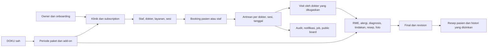

# System inventory ClinicOS

> **Status terbaru setelah P2, 11 November 2026:** Tidak ada model, migration atau route baru. Middleware AuthenticateSession ditambahkan; gate add-on diperketat dan lima dependency Symfony berubah pada patch 7.4. Arsitektur Laravel/Blade/Volt tetap. Lihat [P2_RETEST_REPORT.md](P2_RETEST_REPORT.md) dan [FINAL_QA_REPORT.md](FINAL_QA_REPORT.md).

## Riwayat laporan sebelum perbaikan P2

Bagian di bawah mempertahankan checkpoint P1 dan baseline audit; status/angka historis tidak menggantikan hasil terbaru di atas.

> **Pembaruan setelah perbaikan P1, 11 November 2026:** QA-01 - QA-04 sudah FIXED pada pengujian ulang; P2 belum diperbaiki. Hasil terbaru: [P1_FIX_REPORT.md](P1_FIX_REPORT.md), [STAFF_LIFECYCLE_REPORT.md](STAFF_LIFECYCLE_REPORT.md), [FINAL_QA_REPORT.md](FINAL_QA_REPORT.md). Dua bug staf baru QA-13/QA-14 dan risiko sesi setelah reset admin tetap terbuka.

## Baseline audit sebelum perbaikan

Bagian berikut mempertahankan hasil/source yang diamati saat audit awal. Angka, status FAIL P1 dan batas pada baseline ini bukan status terbaru; bukti lama tidak ditimpa.

Audit 11 November 2026, Asia/Bangkok; HEAD `b82237d932478df9ed02240cb698acff9b4ec669`. Aplikasi adalah SaaS klinik monolith Laravel, Blade, Livewire/Volt, Alpine, Tailwind, dengan database bersama dan isolasi klinik. Beban yang diasumsikan: beberapa staf/dokter dan pasien mengakses klinik bersamaan; kapasitas/beban produksi tidak dibenchmark.

## Sumber dan baseline

Sumber: AGENTS.md, PROJECT_ANALYSIS.md, Development-Plan.md (versi add-on 3 November), PRD.md, Plan.md, design (1).md, README, tiga README fitur dalam docs/, serta dokumen audit/fix historis dalam docs/audit/. Instruksi audit yang dilampirkan menjadi scope tugas. Laporan lama tidak dipakai sebagai hasil test saat ini. SRS/PDF desain/RPP lengkap tidak tersedia dalam workspace audit ini, sehingga compliance penuh terhadap dokumen tersebut NOT TESTED.

Versi terverifikasi: PHP 8.5.5; Laravel 13.34.0; Livewire 3.8.10; Volt 1.11.2; Reverb 1.12.0; Socialite 5.31.0; Spatie Permission 8.3.0; PHPUnit 12.5.37; Pint 1.32.1; Vite 8.3.4; Tailwind 3.4.17. Manifest/lock tidak diubah.

Inventaris: 117 baris route pada environment `testing`, APP_URL `http://localhost`; 107 route aplikasi dan 10 endpoint framework/health/tooling. Ada 88 file view, termasuk 34 komponen Blade; 29 model Eloquent ditambah satu file scope; 40 migration; 54 file PHPUnit existing. Route kondisi environment/domain lain dapat berbeda.

Role tersimpan: Clinic Admin, Receptionist, Doctor, Patient, Platform Admin. Owner memakai account_type `clinic_owner`, role Clinic Admin, dan relasi owner eksplisit. Guest dan akun tanpa role adalah persona akses, bukan role baru. Patient dapat melihat resep final miliknya melalui dashboard khusus; ini bukan akses umum ke SOAP/foto/rekam medis dokter.

## Katalog fitur, dependensi, dan alur

Status di tabel adalah hasil untuk cakupan yang disebut, bukan klaim semua variasi sudah diuji. Detail setiap test dan batas eksekusi ada pada FEATURE_TEST_MATRIX.

| ID | Fitur/role | Aksi yang tersedia | Awal dan dependensi | Alur → hasil yang diharapkan | Hasil audit |
| --- | --- | --- | --- | --- | --- |
| F01 | Login/logout; semua role | Portal pasien `/login`, pengelola `/admin`, remember, logout | Akun aktif; role dan account_type cocok | Login → verifikasi bila perlu → dashboard role; logout mencabut sesi | PASS: lima role browser, batas portal dan inactive |
| F02 | Registrasi Patient | Daftar, persetujuan syarat; Google opsional | Email unik, password valid | Daftar → verifikasi → dashboard/booking | PASS backend; Google nyata BLOCKED |
| F03 | Registrasi owner | Daftar terpisah, pilihan paket dari landing | Email unik, syarat disetujui | Akun owner → verifikasi → buat klinik → paket | PASS browser dengan verifikasi fixture; delivery email BLOCKED |
| F04 | Keamanan akun | Verifikasi/resend, forgot/reset, konfirmasi/update password | Auth/session/signed link, mail | Token sah mengubah status/password; token salah ditolak | PASS fake/backend; transport mail BLOCKED |
| F05 | Profil/hapus akun | Edit nama/email, password, hapus akun | Akun login/current password | Identitas berubah; penghapusan tidak memutus lifecycle tenant | FAIL QA-03; profil umum PASS |
| F06 | Dashboard lima role | Statistik, filter tanggal, ringkasan tugas | Tenant/profil dokter/subscription bila berlaku | Data role/tenant sendiri; role asing ditolak | PASS pada fixture; bukan load test |
| F07 | Onboarding owner | Buat satu klinik, Free/trial/checkout | Owner terverifikasi | Resume langkah yang belum selesai → akses operasional | PASS Free; add-on sebelum klinik FAIL QA-07 |
| F08 | Profil klinik; admin/owner | Identitas, slug, jam, zona waktu, logo, aktif | Clinic policy dan tenant | Simpan → profil publik memakai data tersimpan | PASS terkait; rollback logo NOT TESTED |
| F09 | Tim; admin/owner | Buat dokter/resepsionis, edit, password, aktif/nonaktif, layanan dokter | Kuota seat, email unik, layanan tenant | Akun + profil dokter → verifikasi → login | PASS; bukan editor role/permission umum |
| F10 | Jadwal; admin/owner | List/page, create/edit, kuota, aktif | Dokter tenant, jam klinik, tidak overlap | Sesi tersedia untuk booking tanpa merusak booking lama | FAIL QA-04; create/overlap PASS |
| F11 | Layanan; admin/owner | List/page, create/edit harga/durasi/deskripsi/aktif | Tenant/service policy | Layanan dokter tersedia; snapshot booking mempertahankan harga lama | PASS cakupan existing; update UI tambahan NOT TESTED |
| F12 | Pasien administratif; admin/resepsionis | Create/list/search/detail/edit/nonaktif, duplicate review | Klinik aktor, identitas valid | Nomor RM → profil administratif → booking | PASS create/search/duplicate; update backend tambahan PASS; semua variasi NOT TESTED |
| F13 | Halaman publik klinik; guest/semua akun | Profil, layanan, dokter/jadwal, tautan queue/booking | Subdomain slug klinik aktif, bukan reserved | Informasi hanya klinik pada URL | PASS source/backend dan browser subdomain |
| F14 | Booking online; Patient | Form, sesi/hari, create dengan UUID, prefill profil | Login+verified, klinik/dokter/layanan aktif, kuota | Patient/appointment/queue BOOKED atomik → status rahasia | FAIL QA-01 UI; backend transaksi/idempotency PASS |
| F15 | Booking staf; admin/resepsionis | Pasien lama/baru, duplicate review, create | Relasi satu tenant, sesi tersedia | Appointment + queue satu kali → kelola antrean | PASS browser dengan pasien existing |
| F16 | Status/token booking; pemegang token | Baca dan cancel token | Hash cocok, subscription target, waktu sesi | Status benar; token salah 404; cancel melepas slot | PASS backend; replay token race MySQL BLOCKED |
| F17 | Appointment; staf/pasien | List/page/detail, filter tanggal staf, cancel | Policy tenant atau patient.user_id | Booking sendiri/klinik → pembatalan sesuai lifecycle | PASS ownership dan tenant; bukan reschedule |
| F18 | Antrean; staf/dokter | List/filter/page, check-in/call/skip/return/cancel/no-show/start | Dokter/sesi/tanggal/FIFO dan hak aksi | BOOKED→WAITING→CALLED→IN_PROGRESS→COMPLETED | PASS backend dan perjalanan lintas role browser |
| F19 | Visit/RME; assigned Doctor | Start, buka, draft, autosave, validasi, finalisasi | Queue CALLED; visit ditugaskan; draft aktif | Draft tersimpan tanpa final; finalize empat entitas atomik | PASS alur biasa; QA-05/06/08 membatasi integritas |
| F20 | Diagnosis/tindakan terstruktur; Doctor | Tambah/hapus baris, primary, kode, jumlah tindakan | Visit dan validasi RME | Struktur tersimpan dan tampil ulang | PASS termasuk browser existing; nullable FAIL QA-06 |
| F21 | Resep; Doctor, Patient terbatas | Editor free text, preview, finalisasi; pasien baca resep final sendiri | Visit final milik pasien untuk pembacaan pasien | Draft boleh belum lengkap; final memerlukan kelengkapan | PASS; katalog/interaksi/cetak belum tersedia |
| F22 | Alergi; Doctor | Create, revisi/deactivate, severity, acknowledgement | Visit aktif milik dokter, patient lock/version | Alert kritis; perubahan historis dipertahankan | PASS backend/browser; versi dapat dihilangkan di kontrak server |
| F23 | Odontogram; Doctor | 32 gigi, kondisi, histori read-only; edit dengan add-on | Paid Individual/Team + add-on aktif + policy visit | Data persisten, edit ditolak tanpa hak; General tetap dapat selesai | PASS test entitlement; operational DOKU BLOCKED |
| F24 | Lampiran medis; Doctor | Upload, preview, policy read, remove | Private local disk, jpg/png/webp ≤5 MB/file | File tersimpan aman dan histori tidak putus | FAIL QA-02 dan QA-08 |
| F25 | Modification RME final; Doctor | Koreksi beralasan, snapshot sebelum/sesudah | Assigned Doctor; alasan ≥10 karakter | Status tetap final, histori lengkap, konflik terdeteksi | FAIL QA-02/05; koreksi teks biasa PASS |
| F26 | ETA/display; publik/pasien | Perkiraan/rentang/confidence, current call | Riwayat 20 visit dokter atau durasi layanan | Perkiraan per sesi/tanggal; tanpa identitas pasien di board | PASS estimator/backend; akurasi lapangan NOT TESTED |
| F27 | Notifikasi; akun terkait | List/page, read/read-all, database+broadcast | Patient/doctor penerima; worker untuk broadcast | Transisi tercatat transaksional, delivery retry | PASS job/database/fake; read-all ownership tambahan PASS; WebSocket BLOCKED |
| F28 | Audit; admin/platform sesuai area | List/page/filter, catat auth/domain/platform | Tenant/permission, metadata aman | Jejak pelaku/aksi tanpa token atau isi medis | PASS; storage tamper/retensi produksi NOT TESTED |
| F29 | Subscription; owner | Free, trial sekali, bayar/renew, status, batas seat/kunjungan | Katalog, periode, subscription satu klinik | Expiry membatasi tulis; visit aktif tetap bisa diselesaikan | PASS fake/backend; entitlement premium lain masih gap |
| F30 | Pembayaran SaaS; owner/platform/provider | Invoice/list/detail/checkout/reconcile, callback, dedupe, refund manual | DOKU valid; owner/permission platform; snapshot | Redirect tidak aktifkan akses; event sah aktivasi tepat sekali | PASS fake/provider contract; DOKU nyata BLOCKED |
| F31 | Commerce add-on; owner/platform | Prorata, combined/standalone invoice, katalog, refund/revoke | Paid period aktif, harga aktif, target periode | Hak edit berakhir bersama paket; histori tetap terbaca | PASS core backend; prasyarat owner FAIL QA-07 |
| F32 | Platform | Tenant metadata/search/detail, katalog harga, grant/downgrade, pembayaran | Role+permission platform | Kelola aspek nonmedis tanpa membuka isi medis | PASS izin dan grant; suspend/transfer owner belum tersedia |
| F33 | Operasional | Health, scheduler reminder, database queue, Reverb config, deploy workflow | Service eksternal dan proses operasional | Job terkirim; health dan rilis tervalidasi | PASS worker null/scheduler registry/build; production BLOCKED |

## Perbandingan backend, UI, database

Odontogram, alergi, autosave, diagnosis/tindakan terstruktur, ETA, dan resep pasien kini mempunyai integrasi tersimpan; klaim lama bahwa semuanya hanya UI tidak berlaku untuk checkout ini. Sebaliknya, QA-01 menunjukkan adanya backend booking tanpa alur UI publik yang bekerja.

Billing/receipt pasien, export laporan, discovery klinik, multi-cabang, dan Edge Mode belum mempunyai alur/domain lengkap. Payment yang ada adalah pembayaran subscription SaaS. Nilai layanan visit bukan bukti penerimaan kas. Rincian gap ada di MISSING_FEATURES.

## Model dan proses lintas fitur

Scope ClinicScope hanya Patient dengan user ber-clinic_id. Entitas lain membutuhkan filter/policy eksplisit. Foreign key individual tidak membuktikan konsistensi dokter/klinik/sesi; QA-04 membuktikan kegagalan salah satu relasi tersebut.

## Lampiran inventaris terhitung

Tabel route, view, dan model berikut dihasilkan dari registry dan file aktual. Kemunculan file/route hanya membuktikan keberadaan; status browser dan test terkait dijelaskan terpisah.

### Registry route lengkap

PASS observasi hanya membuktikan request tercatat, bukan seluruh perilaku lulus. Beberapa 500 sengaja dipicu test rollback. Semua 107 baris route aplikasi teramati; sembilan baris framework/health/tooling belum teramati. Policy/resource/entitlement tetap berlaku.

| Method | Domain template | URI template | Nama | Fitur | Guard route | Observasi PHP |
| --- | --- | --- | --- | --- | --- | --- |
| GET\|HEAD | {clinic}.localhost | / | public.clinic.show | F13 | web | PASS: request tercatat |
| GET\|HEAD | localhost | / | welcome | F00 | web | PASS: request tercatat |
| POST |  | _boost/browser-logs | boost.browser-logs | F33 |  | NOT TESTED pada recorder PHP |
| GET\|HEAD | localhost | admin | admin.login | F01 | web; RedirectIfAuthenticated | PASS: request tercatat |
| GET\|HEAD | localhost | admin/audit-logs | admin.audit-logs.index | F28 | web; Authenticate; EnsureEmailIsVerified; EnsureOnboardingComplete; RoleMiddleware:Clinic Admin; EnsureSubscriptionWritable | PASS: request tercatat |
| GET\|HEAD | localhost | admin/clinic | admin.clinic.index | F08 | web; Authenticate; EnsureEmailIsVerified; EnsureOnboardingComplete; RoleMiddleware:Clinic Admin; EnsureSubscriptionWritable | PASS: request tercatat |
| POST | localhost | admin/clinic | admin.clinic.store | F08 | web; Authenticate; EnsureEmailIsVerified; EnsureOnboardingComplete; RoleMiddleware:Clinic Admin; EnsureSubscriptionWritable | PASS: request tercatat |
| GET\|HEAD | localhost | admin/clinic/create | admin.clinic.create | F08 | web; Authenticate; EnsureEmailIsVerified; EnsureOnboardingComplete; RoleMiddleware:Clinic Admin; EnsureSubscriptionWritable | PASS: request tercatat |
| PUT\|PATCH | localhost | admin/clinic/{clinic} | admin.clinic.update | F08 | web; Authenticate; EnsureEmailIsVerified; EnsureOnboardingComplete; RoleMiddleware:Clinic Admin; EnsureSubscriptionWritable | PASS: request tercatat |
| GET\|HEAD | localhost | admin/clinic/{clinic}/edit | admin.clinic.edit | F08 | web; Authenticate; EnsureEmailIsVerified; EnsureOnboardingComplete; RoleMiddleware:Clinic Admin; EnsureSubscriptionWritable | PASS: request tercatat |
| GET\|HEAD | localhost | admin/dashboard | admin.dashboard | F06 | web; Authenticate; EnsureEmailIsVerified; EnsureOnboardingComplete; PermissionMiddleware:dashboard.view; RoleMiddleware:Clinic Admin | PASS: request tercatat |
| GET\|HEAD | localhost | admin/doctor-schedules | admin.doctor-schedules.index | F10 | web; Authenticate; EnsureEmailIsVerified; EnsureOnboardingComplete; RoleMiddleware:Clinic Admin; EnsureSubscriptionWritable | PASS: request tercatat |
| POST | localhost | admin/doctor-schedules | admin.doctor-schedules.store | F10 | web; Authenticate; EnsureEmailIsVerified; EnsureOnboardingComplete; RoleMiddleware:Clinic Admin; EnsureSubscriptionWritable | PASS: request tercatat |
| GET\|HEAD | localhost | admin/doctor-schedules/create | admin.doctor-schedules.create | F10 | web; Authenticate; EnsureEmailIsVerified; EnsureOnboardingComplete; RoleMiddleware:Clinic Admin; EnsureSubscriptionWritable | PASS: request tercatat |
| PUT\|PATCH | localhost | admin/doctor-schedules/{doctor_schedule} | admin.doctor-schedules.update | F10 | web; Authenticate; EnsureEmailIsVerified; EnsureOnboardingComplete; RoleMiddleware:Clinic Admin; EnsureSubscriptionWritable | PASS: request tercatat |
| GET\|HEAD | localhost | admin/doctor-schedules/{doctor_schedule}/edit | admin.doctor-schedules.edit | F10 | web; Authenticate; EnsureEmailIsVerified; EnsureOnboardingComplete; RoleMiddleware:Clinic Admin; EnsureSubscriptionWritable | PASS: request tercatat |
| GET\|HEAD | localhost | admin/services | admin.services.index | F11 | web; Authenticate; EnsureEmailIsVerified; EnsureOnboardingComplete; RoleMiddleware:Clinic Admin; EnsureSubscriptionWritable | PASS: request tercatat |
| POST | localhost | admin/services | admin.services.store | F11 | web; Authenticate; EnsureEmailIsVerified; EnsureOnboardingComplete; RoleMiddleware:Clinic Admin; EnsureSubscriptionWritable | PASS: request tercatat |
| GET\|HEAD | localhost | admin/services/create | admin.services.create | F11 | web; Authenticate; EnsureEmailIsVerified; EnsureOnboardingComplete; RoleMiddleware:Clinic Admin; EnsureSubscriptionWritable | PASS: request tercatat |
| PUT\|PATCH | localhost | admin/services/{service} | admin.services.update | F11 | web; Authenticate; EnsureEmailIsVerified; EnsureOnboardingComplete; RoleMiddleware:Clinic Admin; EnsureSubscriptionWritable | PASS: request tercatat |
| GET\|HEAD | localhost | admin/services/{service}/edit | admin.services.edit | F11 | web; Authenticate; EnsureEmailIsVerified; EnsureOnboardingComplete; RoleMiddleware:Clinic Admin; EnsureSubscriptionWritable | PASS: request tercatat |
| GET\|HEAD | localhost | admin/staff | admin.staff.index | F09 | web; Authenticate; EnsureEmailIsVerified; EnsureOnboardingComplete; RoleMiddleware:Clinic Admin; EnsureSubscriptionWritable | PASS: request tercatat |
| POST | localhost | admin/staff | admin.staff.store | F09 | web; Authenticate; EnsureEmailIsVerified; EnsureOnboardingComplete; RoleMiddleware:Clinic Admin; EnsureSubscriptionWritable | PASS: request tercatat |
| GET\|HEAD | localhost | admin/staff/create | admin.staff.create | F09 | web; Authenticate; EnsureEmailIsVerified; EnsureOnboardingComplete; RoleMiddleware:Clinic Admin; EnsureSubscriptionWritable | PASS: request tercatat |
| PUT\|PATCH | localhost | admin/staff/{staff} | admin.staff.update | F09 | web; Authenticate; EnsureEmailIsVerified; EnsureOnboardingComplete; RoleMiddleware:Clinic Admin; EnsureSubscriptionWritable | PASS: request tercatat |
| GET\|HEAD | localhost | admin/staff/{staff}/edit | admin.staff.edit | F09 | web; Authenticate; EnsureEmailIsVerified; EnsureOnboardingComplete; RoleMiddleware:Clinic Admin; EnsureSubscriptionWritable | PASS: request tercatat |
| GET\|HEAD | localhost | auth/google | auth.google.redirect | F04 | web; RedirectIfAuthenticated | PASS: request tercatat |
| GET\|HEAD | localhost | auth/google/callback | auth.google.callback | F04 | web; RedirectIfAuthenticated; ThrottleRequests:6,1 | PASS: request tercatat |
| POST | localhost | booking/{appointment}/cancel | public.booking.cancel | F16 | web; EnsureSubscriptionWritable; ThrottleRequests:10,1 | PASS: request tercatat |
| GET\|HEAD | localhost | booking/{appointment}/status | public.booking.status | F16 | web; ThrottleRequests:30,1 | PASS: request tercatat |
| GET\|POST\|HEAD |  | broadcasting/auth | (unnamed) | F33 | web | NOT TESTED pada recorder PHP |
| GET\|HEAD | localhost | clinic/{clinic:slug}/booking | public.booking.create | F14 | web; Authenticate; EnsureEmailIsVerified; RoleMiddleware:Patient | PASS: request tercatat |
| POST | localhost | clinic/{clinic:slug}/booking | public.booking.store | F14 | web; Authenticate; EnsureEmailIsVerified; RoleMiddleware:Patient; EnsureSubscriptionWritable; ThrottleRequests:10,1 | PASS: request tercatat |
| GET\|HEAD | localhost | confirm-password | password.confirm | F04 | web; Authenticate | PASS: request tercatat |
| GET\|HEAD | localhost | dashboard | dashboard | F06 | web; Authenticate; EnsureEmailIsVerified; RedirectToDashboard | PASS: request tercatat |
| GET\|HEAD | localhost | display/{clinicSlugOrToken} | public.queue.display | F26 | web; ThrottleRequests:60,1 | PASS: request tercatat |
| GET\|HEAD | localhost | doctor/dashboard | doctor.dashboard | F06 | web; Authenticate; EnsureEmailIsVerified; EnsureOnboardingComplete; PermissionMiddleware:dashboard.view; RoleMiddleware:Doctor | PASS: request tercatat |
| GET\|HEAD | localhost | doctor/medical-records | doctor.medical-records.index | F19/F20/F21 | web; Authenticate; EnsureEmailIsVerified; EnsureOnboardingComplete; RoleMiddleware:Doctor; EnsureSubscriptionWritable | PASS: request tercatat |
| GET\|HEAD | localhost | doctor/queues | doctor.queues.index | F18 | web; Authenticate; EnsureEmailIsVerified; EnsureOnboardingComplete; RoleMiddleware:Doctor; EnsureSubscriptionWritable | PASS: request tercatat |
| POST | localhost | doctor/queues/{queue}/start | doctor.visits.start | F19/F20/F21 | web; Authenticate; EnsureEmailIsVerified; EnsureOnboardingComplete; RoleMiddleware:Doctor; EnsureSubscriptionWritable | PASS: request tercatat |
| GET\|HEAD | localhost | doctor/visits/{visit} | doctor.visits.show | F19/F20/F21 | web; Authenticate; EnsureEmailIsVerified; EnsureOnboardingComplete; RoleMiddleware:Doctor; EnsureSubscriptionWritable | PASS: request tercatat |
| POST | localhost | doctor/visits/{visit}/allergies | doctor.visits.allergies.store | F22 | web; Authenticate; EnsureEmailIsVerified; EnsureOnboardingComplete; RoleMiddleware:Doctor; EnsureSubscriptionWritable | PASS: request tercatat |
| PUT | localhost | doctor/visits/{visit}/allergies/{allergy} | doctor.visits.allergies.update | F22 | web; Authenticate; EnsureEmailIsVerified; EnsureOnboardingComplete; RoleMiddleware:Doctor; EnsureSubscriptionWritable | PASS: request tercatat |
| PUT | localhost | doctor/visits/{visit}/complete | doctor.visits.complete | F19/F20/F21 | web; Authenticate; EnsureEmailIsVerified; EnsureOnboardingComplete; RoleMiddleware:Doctor; EnsureSubscriptionWritable | PASS: request tercatat |
| PUT | localhost | doctor/visits/{visit}/correct | doctor.visits.correct | F25 | web; Authenticate; EnsureEmailIsVerified; EnsureOnboardingComplete; RoleMiddleware:Doctor; EnsureSubscriptionWritable | PASS: request tercatat |
| PUT | localhost | doctor/visits/{visit}/draft | doctor.visits.save | F19/F20/F21 | web; Authenticate; EnsureEmailIsVerified; EnsureOnboardingComplete; RoleMiddleware:Doctor; EnsureSubscriptionWritable | PASS: request tercatat |
| GET\|HEAD | localhost | doctor/visits/{visit}/photos/{photo} | doctor.visits.photos.show | F24 | web; Authenticate; EnsureEmailIsVerified; EnsureOnboardingComplete; RoleMiddleware:Doctor; EnsureSubscriptionWritable | PASS: request tercatat |
| GET\|HEAD | localhost | forgot-password | password.request | F04 | web; RedirectIfAuthenticated | PASS: request tercatat |
| GET\|HEAD |  | livewire/livewire.js | (unnamed) | F33 |  | NOT TESTED pada recorder PHP |
| GET\|HEAD |  | livewire/livewire.min.js.map | (unnamed) | F33 |  | NOT TESTED pada recorder PHP |
| GET\|HEAD |  | livewire/preview-file/{filename} | livewire.preview-file | F33 | web | NOT TESTED pada recorder PHP |
| POST |  | livewire/update | default.livewire.update | F33 | web | PASS: request tercatat |
| POST |  | livewire/upload-file | livewire.upload-file | F33 | web; ThrottleRequests:60,1 | NOT TESTED pada recorder PHP |
| GET\|HEAD | localhost | login | login | F01 | web; RedirectIfAuthenticated | PASS: request tercatat |
| GET\|HEAD | localhost | notifications | notifications.index | F27 | web; Authenticate; EnsureEmailIsVerified; EnsureOnboardingComplete | PASS: request tercatat |
| POST | localhost | notifications/read-all | notifications.read-all | F27 | web; Authenticate; EnsureEmailIsVerified; EnsureOnboardingComplete | PASS: request tercatat |
| POST | localhost | notifications/{notification}/read | notifications.read | F27 | web; Authenticate; EnsureEmailIsVerified; EnsureOnboardingComplete | PASS: request tercatat |
| GET\|HEAD | localhost | onboarding/clinic | onboarding.clinic.create | F07 | web; Authenticate; EnsureEmailIsVerified; EnsureClinicOwner | PASS: request tercatat |
| POST | localhost | onboarding/clinic | onboarding.clinic.store | F07 | web; Authenticate; EnsureEmailIsVerified; EnsureClinicOwner | PASS: request tercatat |
| GET\|HEAD | localhost | onboarding/plans | onboarding.plans.index | F29 | web; Authenticate; EnsureEmailIsVerified; EnsureClinicOwner | PASS: request tercatat |
| POST | localhost | onboarding/plans/free | onboarding.plans.free | F29 | web; Authenticate; EnsureEmailIsVerified; EnsureClinicOwner | PASS: request tercatat |
| POST | localhost | onboarding/plans/paid/{subscriptionPrice} | onboarding.plans.paid | F29 | web; Authenticate; EnsureEmailIsVerified; EnsureClinicOwner; ThrottleRequests:checkout | PASS: request tercatat |
| POST | localhost | onboarding/plans/trial | onboarding.plans.trial | F29 | web; Authenticate; EnsureEmailIsVerified; EnsureClinicOwner | PASS: request tercatat |
| GET\|HEAD | localhost | patient/appointments | patient.appointments.index | F17 | web; Authenticate; EnsureEmailIsVerified; EnsureOnboardingComplete; RoleMiddleware:Patient; EnsureSubscriptionWritable | PASS: request tercatat |
| GET\|HEAD | localhost | patient/appointments/{appointment} | patient.appointments.show | F17 | web; Authenticate; EnsureEmailIsVerified; EnsureOnboardingComplete; RoleMiddleware:Patient; EnsureSubscriptionWritable | PASS: request tercatat |
| POST | localhost | patient/appointments/{appointment}/cancel | patient.appointments.cancel | F17 | web; Authenticate; EnsureEmailIsVerified; EnsureOnboardingComplete; RoleMiddleware:Patient; EnsureSubscriptionWritable | PASS: request tercatat |
| GET\|HEAD | localhost | patient/dashboard | patient.dashboard | F06 | web; Authenticate; EnsureEmailIsVerified; EnsureOnboardingComplete; PermissionMiddleware:dashboard.view; RoleMiddleware:Patient | PASS: request tercatat |
| POST | localhost | payments/doku/notification | doku.notifications | F30 | web; ThrottleRequests:doku-notification | PASS: request tercatat |
| PATCH | localhost | platform/addon-prices/{addonPrice} | platform.addon-prices.update | F32 | web; Authenticate; EnsureEmailIsVerified; RoleMiddleware:Platform Admin; PermissionMiddleware:platform.plan.manage | PASS: request tercatat |
| GET\|HEAD | localhost | platform/dashboard | platform.dashboard | F32 | web; Authenticate; EnsureEmailIsVerified; RoleMiddleware:Platform Admin; PermissionMiddleware:platform.dashboard.view | PASS: request tercatat |
| GET\|HEAD | localhost | platform/payments | platform.payments.index | F30 | web; Authenticate; EnsureEmailIsVerified; RoleMiddleware:Platform Admin; PermissionMiddleware:platform.payment.view | PASS: request tercatat |
| GET\|HEAD | localhost | platform/payments/{payment} | platform.payments.show | F30 | web; Authenticate; EnsureEmailIsVerified; RoleMiddleware:Platform Admin; PermissionMiddleware:platform.payment.view; ThrottleRequests:payment-status | PASS: request tercatat |
| POST | localhost | platform/payments/{payment}/reconcile | platform.payments.reconcile | F30 | web; Authenticate; EnsureEmailIsVerified; RoleMiddleware:Platform Admin; PermissionMiddleware:platform.payment.manage; ThrottleRequests:payment-status | PASS: request tercatat |
| POST | localhost | platform/payments/{payment}/refund | platform.payments.refund | F30 | web; Authenticate; EnsureEmailIsVerified; RoleMiddleware:Platform Admin; PermissionMiddleware:platform.payment.manage | PASS: request tercatat |
| GET\|HEAD | localhost | platform/subscription-plans | platform.subscription-plans.index | F32 | web; Authenticate; EnsureEmailIsVerified; RoleMiddleware:Platform Admin; PermissionMiddleware:platform.plan.manage | PASS: request tercatat |
| PATCH | localhost | platform/subscription-plans/{subscriptionPlan} | platform.subscription-plans.update | F32 | web; Authenticate; EnsureEmailIsVerified; RoleMiddleware:Platform Admin; PermissionMiddleware:platform.plan.manage | PASS: request tercatat |
| PATCH | localhost | platform/subscription-prices/{subscriptionPrice} | platform.subscription-prices.update | F32 | web; Authenticate; EnsureEmailIsVerified; RoleMiddleware:Platform Admin; PermissionMiddleware:platform.plan.manage | PASS: request tercatat |
| GET\|HEAD | localhost | platform/tenants | platform.tenants.index | F32 | web; Authenticate; EnsureEmailIsVerified; RoleMiddleware:Platform Admin; PermissionMiddleware:platform.tenant.view | PASS: request tercatat |
| GET\|HEAD | localhost | platform/tenants/{clinic} | platform.tenants.show | F32 | web; Authenticate; EnsureEmailIsVerified; RoleMiddleware:Platform Admin; PermissionMiddleware:platform.tenant.view | PASS: request tercatat |
| POST | localhost | platform/tenants/{clinic}/subscription-grants | platform.subscription-grants.store | F32 | web; Authenticate; EnsureEmailIsVerified; RoleMiddleware:Platform Admin; PermissionMiddleware:platform.subscription.grant | PASS: request tercatat |
| GET\|HEAD | localhost | previews/visit-summary | previews.visit-summary | F33 | web | PASS: request tercatat |
| GET\|HEAD | localhost | profile | profile | F05 | web; Authenticate | PASS: request tercatat |
| GET\|HEAD | {clinic}.localhost | queue | public.queue.index | F26 | web; ThrottleRequests:60,1 | PASS: request tercatat |
| POST | localhost | queues/{queue}/call | queues.call | F18 | web; Authenticate; EnsureEmailIsVerified; EnsureOnboardingComplete; RoleMiddleware:Clinic Admin\|Receptionist\|Doctor; EnsureSubscriptionWritable | PASS: request tercatat |
| POST | localhost | queues/{queue}/cancel | queues.cancel | F18 | web; Authenticate; EnsureEmailIsVerified; EnsureOnboardingComplete; RoleMiddleware:Clinic Admin\|Receptionist\|Doctor; EnsureSubscriptionWritable | PASS: request tercatat |
| POST | localhost | queues/{queue}/check-in | queues.check-in | F18 | web; Authenticate; EnsureEmailIsVerified; EnsureOnboardingComplete; RoleMiddleware:Clinic Admin\|Receptionist\|Doctor; EnsureSubscriptionWritable | PASS: request tercatat |
| POST | localhost | queues/{queue}/no-show | queues.no-show | F18 | web; Authenticate; EnsureEmailIsVerified; EnsureOnboardingComplete; RoleMiddleware:Clinic Admin\|Receptionist\|Doctor; EnsureSubscriptionWritable | PASS: request tercatat |
| POST | localhost | queues/{queue}/return | queues.return | F18 | web; Authenticate; EnsureEmailIsVerified; EnsureOnboardingComplete; RoleMiddleware:Clinic Admin\|Receptionist\|Doctor; EnsureSubscriptionWritable | PASS: request tercatat |
| POST | localhost | queues/{queue}/skip | queues.skip | F18 | web; Authenticate; EnsureEmailIsVerified; EnsureOnboardingComplete; RoleMiddleware:Clinic Admin\|Receptionist\|Doctor; EnsureSubscriptionWritable | PASS: request tercatat |
| GET\|HEAD | localhost | receptionist/appointments | receptionist.appointments.index | F17 | web; Authenticate; EnsureEmailIsVerified; EnsureOnboardingComplete; RoleMiddleware:Clinic Admin\|Receptionist; EnsureSubscriptionWritable | PASS: request tercatat |
| POST | localhost | receptionist/appointments | receptionist.appointments.store | F17 | web; Authenticate; EnsureEmailIsVerified; EnsureOnboardingComplete; RoleMiddleware:Clinic Admin\|Receptionist; EnsureSubscriptionWritable | PASS: request tercatat |
| GET\|HEAD | localhost | receptionist/appointments/create | receptionist.appointments.create | F17 | web; Authenticate; EnsureEmailIsVerified; EnsureOnboardingComplete; RoleMiddleware:Clinic Admin\|Receptionist; EnsureSubscriptionWritable | PASS: request tercatat |
| GET\|HEAD | localhost | receptionist/appointments/{appointment} | receptionist.appointments.show | F17 | web; Authenticate; EnsureEmailIsVerified; EnsureOnboardingComplete; RoleMiddleware:Clinic Admin\|Receptionist; EnsureSubscriptionWritable | PASS: request tercatat |
| POST | localhost | receptionist/appointments/{appointment}/cancel | receptionist.appointments.cancel | F17 | web; Authenticate; EnsureEmailIsVerified; EnsureOnboardingComplete; RoleMiddleware:Clinic Admin\|Receptionist; EnsureSubscriptionWritable | PASS: request tercatat |
| GET\|HEAD | localhost | receptionist/dashboard | receptionist.dashboard | F06 | web; Authenticate; EnsureEmailIsVerified; EnsureOnboardingComplete; PermissionMiddleware:dashboard.view; RoleMiddleware:Receptionist | PASS: request tercatat |
| GET\|HEAD | localhost | receptionist/patients | receptionist.patients.index | F12 | web; Authenticate; EnsureEmailIsVerified; EnsureOnboardingComplete; RoleMiddleware:Clinic Admin\|Receptionist; EnsureSubscriptionWritable | PASS: request tercatat |
| POST | localhost | receptionist/patients | receptionist.patients.store | F12 | web; Authenticate; EnsureEmailIsVerified; EnsureOnboardingComplete; RoleMiddleware:Clinic Admin\|Receptionist; EnsureSubscriptionWritable | PASS: request tercatat |
| GET\|HEAD | localhost | receptionist/patients/create | receptionist.patients.create | F12 | web; Authenticate; EnsureEmailIsVerified; EnsureOnboardingComplete; RoleMiddleware:Clinic Admin\|Receptionist; EnsureSubscriptionWritable | PASS: request tercatat |
| POST | localhost | receptionist/patients/duplicates | receptionist.patients.duplicates | F12 | web; Authenticate; EnsureEmailIsVerified; EnsureOnboardingComplete; RoleMiddleware:Clinic Admin\|Receptionist; EnsureSubscriptionWritable; ThrottleRequests:30,1 | PASS: request tercatat |
| GET\|HEAD | localhost | receptionist/patients/search | receptionist.patients.search | F12 | web; Authenticate; EnsureEmailIsVerified; EnsureOnboardingComplete; RoleMiddleware:Clinic Admin\|Receptionist; EnsureSubscriptionWritable | PASS: request tercatat |
| GET\|HEAD | localhost | receptionist/patients/{patient} | receptionist.patients.show | F12 | web; Authenticate; EnsureEmailIsVerified; EnsureOnboardingComplete; RoleMiddleware:Clinic Admin\|Receptionist; EnsureSubscriptionWritable | PASS: request tercatat |
| PUT\|PATCH | localhost | receptionist/patients/{patient} | receptionist.patients.update | F12 | web; Authenticate; EnsureEmailIsVerified; EnsureOnboardingComplete; RoleMiddleware:Clinic Admin\|Receptionist; EnsureSubscriptionWritable | PASS: request tercatat |
| GET\|HEAD | localhost | receptionist/patients/{patient}/edit | receptionist.patients.edit | F12 | web; Authenticate; EnsureEmailIsVerified; EnsureOnboardingComplete; RoleMiddleware:Clinic Admin\|Receptionist; EnsureSubscriptionWritable | PASS: request tercatat |
| GET\|HEAD | localhost | receptionist/queues | receptionist.queues.index | F18 | web; Authenticate; EnsureEmailIsVerified; EnsureOnboardingComplete; RoleMiddleware:Clinic Admin\|Receptionist; EnsureSubscriptionWritable | PASS: request tercatat |
| GET\|HEAD | localhost | register | register | F02 | web; RedirectIfAuthenticated | PASS: request tercatat |
| GET\|HEAD | localhost | register/clinic | register.clinic | F03 | web; RedirectIfAuthenticated | PASS: request tercatat |
| GET\|HEAD | localhost | reset-password/{token} | password.reset | F04 | web; RedirectIfAuthenticated | PASS: request tercatat |
| GET\|HEAD |  | storage/{path} | storage.local | F33 |  | NOT TESTED pada recorder PHP |
| PUT |  | storage/{path} | storage.local.upload | F33 |  | NOT TESTED pada recorder PHP |
| GET\|HEAD | localhost | subscription/addons | subscription.addons.index | F31 | web; Authenticate; EnsureEmailIsVerified; EnsureClinicOwner; ThrottleRequests:payment-status | PASS: request tercatat |
| POST | localhost | subscription/addons/odontogram | subscription.addons.store | F31 | web; Authenticate; EnsureEmailIsVerified; EnsureClinicOwner; ThrottleRequests:payment-status; ThrottleRequests:checkout | PASS: request tercatat |
| GET\|HEAD | localhost | subscription/payments | subscription.payments.index | F30 | web; Authenticate; EnsureEmailIsVerified; EnsureClinicOwner; ThrottleRequests:payment-status | PASS: request tercatat |
| GET\|HEAD | localhost | subscription/payments/{payment} | subscription.payments.show | F30 | web; Authenticate; EnsureEmailIsVerified; EnsureClinicOwner; ThrottleRequests:payment-status | PASS: request tercatat |
| POST | localhost | subscription/payments/{payment}/reconcile | subscription.payments.reconcile | F30 | web; Authenticate; EnsureEmailIsVerified; EnsureClinicOwner; ThrottleRequests:payment-status | PASS: request tercatat |
| GET\|HEAD |  | up | (unnamed) | F33 |  | NOT TESTED pada recorder PHP |
| GET\|HEAD | localhost | verify-email | verification.notice | F04 | web; Authenticate | PASS: request tercatat |
| GET\|HEAD | localhost | verify-email/{id}/{hash} | verification.verify | F04 | web; Authenticate; ValidateSignature; ThrottleRequests:6,1 | PASS: request tercatat |

### Seluruh view (88 file)

Status render dibatasi pada request 200 yang tercatat. Satu form dapat melayani beberapa role/action. Komponen/layout bukan state independen yang seluruh prop-nya telah diuji. Event::fake dapat menekan recorder; bukti browser dan assertion di test tetap perlu dibaca terpisah.

| View | Jenis | Entry point/integrasi | Hasil terbatas |
| --- | --- | --- | --- |
| [resources/views/admin/audit-logs/index.blade.php](../resources/views/admin/audit-logs/index.blade.php) | Page/fragment | admin.audit-logs.index | PASS render pada request 200 teramati; seluruh state NOT TESTED |
| [resources/views/admin/clinic/form.blade.php](../resources/views/admin/clinic/form.blade.php) | Page/fragment | admin.clinic.create, admin.clinic.edit, onboarding.clinic.create | PASS render pada request 200 teramati; seluruh state NOT TESTED |
| [resources/views/admin/dashboard.blade.php](../resources/views/admin/dashboard.blade.php) | Page/fragment | admin.dashboard | PASS render pada request 200 teramati; seluruh state NOT TESTED |
| [resources/views/admin/schedules/form.blade.php](../resources/views/admin/schedules/form.blade.php) | Page/fragment | admin.doctor-schedules.create, admin.doctor-schedules.edit | PASS render pada request 200 teramati; seluruh state NOT TESTED |
| [resources/views/admin/schedules/index.blade.php](../resources/views/admin/schedules/index.blade.php) | Page/fragment | admin.doctor-schedules.index | PASS render pada request 200 teramati; seluruh state NOT TESTED |
| [resources/views/admin/services/form.blade.php](../resources/views/admin/services/form.blade.php) | Page/fragment | admin.services.create, admin.services.edit | PASS render pada request 200 teramati; seluruh state NOT TESTED |
| [resources/views/admin/services/index.blade.php](../resources/views/admin/services/index.blade.php) | Page/fragment | admin.services.index | PASS render pada request 200 teramati; seluruh state NOT TESTED |
| [resources/views/admin/staff/form.blade.php](../resources/views/admin/staff/form.blade.php) | Page/fragment | admin.staff.create, admin.staff.edit | PASS render pada request 200 teramati; seluruh state NOT TESTED |
| [resources/views/admin/staff/index.blade.php](../resources/views/admin/staff/index.blade.php) | Page/fragment | admin.staff.index | PASS render pada request 200 teramati; seluruh state NOT TESTED |
| [resources/views/components/action-message.blade.php](../resources/views/components/action-message.blade.php) | Shared component | Komposisi layout/page; bukan route mandiri | NOT TESTED sebagai halaman/state independen; lihat assertion/bukti browser terkait |
| [resources/views/components/application-logo.blade.php](../resources/views/components/application-logo.blade.php) | Shared component | Komposisi layout/page; bukan route mandiri | NOT TESTED sebagai halaman/state independen; lihat assertion/bukti browser terkait |
| [resources/views/components/appointment-queue-status.blade.php](../resources/views/components/appointment-queue-status.blade.php) | Shared component | Komposisi layout/page; bukan route mandiri | NOT TESTED sebagai halaman/state independen; lihat assertion/bukti browser terkait |
| [resources/views/components/auth-session-status.blade.php](../resources/views/components/auth-session-status.blade.php) | Shared component | Komposisi layout/page; bukan route mandiri | NOT TESTED sebagai halaman/state independen; lihat assertion/bukti browser terkait |
| [resources/views/components/booking-fields.blade.php](../resources/views/components/booking-fields.blade.php) | Shared component | Komposisi layout/page; bukan route mandiri | NOT TESTED sebagai halaman/state independen; lihat assertion/bukti browser terkait |
| [resources/views/components/clinic-button.blade.php](../resources/views/components/clinic-button.blade.php) | Shared component | Komposisi layout/page; bukan route mandiri | NOT TESTED sebagai halaman/state independen; lihat assertion/bukti browser terkait |
| [resources/views/components/critical-allergy-banner.blade.php](../resources/views/components/critical-allergy-banner.blade.php) | Shared component | Komposisi layout/page; bukan route mandiri | NOT TESTED sebagai halaman/state independen; lihat assertion/bukti browser terkait |
| [resources/views/components/danger-button.blade.php](../resources/views/components/danger-button.blade.php) | Shared component | Komposisi layout/page; bukan route mandiri | NOT TESTED sebagai halaman/state independen; lihat assertion/bukti browser terkait |
| [resources/views/components/dental-chart.blade.php](../resources/views/components/dental-chart.blade.php) | Shared component | Komposisi layout/page; bukan route mandiri | NOT TESTED sebagai halaman/state independen; lihat assertion/bukti browser terkait |
| [resources/views/components/dropdown.blade.php](../resources/views/components/dropdown.blade.php) | Shared component | Komposisi layout/page; bukan route mandiri | NOT TESTED sebagai halaman/state independen; lihat assertion/bukti browser terkait |
| [resources/views/components/dropdown-link.blade.php](../resources/views/components/dropdown-link.blade.php) | Shared component | Komposisi layout/page; bukan route mandiri | NOT TESTED sebagai halaman/state independen; lihat assertion/bukti browser terkait |
| [resources/views/components/input-error.blade.php](../resources/views/components/input-error.blade.php) | Shared component | Komposisi layout/page; bukan route mandiri | NOT TESTED sebagai halaman/state independen; lihat assertion/bukti browser terkait |
| [resources/views/components/input-label.blade.php](../resources/views/components/input-label.blade.php) | Shared component | Komposisi layout/page; bukan route mandiri | NOT TESTED sebagai halaman/state independen; lihat assertion/bukti browser terkait |
| [resources/views/components/medical-record-modification.blade.php](../resources/views/components/medical-record-modification.blade.php) | Shared component | Komposisi layout/page; bukan route mandiri | NOT TESTED sebagai halaman/state independen; lihat assertion/bukti browser terkait |
| [resources/views/components/modal.blade.php](../resources/views/components/modal.blade.php) | Shared component | Komposisi layout/page; bukan route mandiri | NOT TESTED sebagai halaman/state independen; lihat assertion/bukti browser terkait |
| [resources/views/components/nav-link.blade.php](../resources/views/components/nav-link.blade.php) | Shared component | Komposisi layout/page; bukan route mandiri | NOT TESTED sebagai halaman/state independen; lihat assertion/bukti browser terkait |
| [resources/views/components/patient-duplicate-review.blade.php](../resources/views/components/patient-duplicate-review.blade.php) | Shared component | Komposisi layout/page; bukan route mandiri | NOT TESTED sebagai halaman/state independen; lihat assertion/bukti browser terkait |
| [resources/views/components/primary-button.blade.php](../resources/views/components/primary-button.blade.php) | Shared component | Komposisi layout/page; bukan route mandiri | NOT TESTED sebagai halaman/state independen; lihat assertion/bukti browser terkait |
| [resources/views/components/public-layout.blade.php](../resources/views/components/public-layout.blade.php) | Shared component | Komposisi layout/page; bukan route mandiri | NOT TESTED sebagai halaman/state independen; lihat assertion/bukti browser terkait |
| [resources/views/components/public-queue-screen.blade.php](../resources/views/components/public-queue-screen.blade.php) | Shared component | Komposisi layout/page; bukan route mandiri | NOT TESTED sebagai halaman/state independen; lihat assertion/bukti browser terkait |
| [resources/views/components/queue-card.blade.php](../resources/views/components/queue-card.blade.php) | Shared component | Komposisi layout/page; bukan route mandiri | NOT TESTED sebagai halaman/state independen; lihat assertion/bukti browser terkait |
| [resources/views/components/queue-number-display.blade.php](../resources/views/components/queue-number-display.blade.php) | Shared component | Komposisi layout/page; bukan route mandiri | NOT TESTED sebagai halaman/state independen; lihat assertion/bukti browser terkait |
| [resources/views/components/receptionist/search-select.blade.php](../resources/views/components/receptionist/search-select.blade.php) | Shared component | Komposisi layout/page; bukan route mandiri | NOT TESTED sebagai halaman/state independen; lihat assertion/bukti browser terkait |
| [resources/views/components/responsive-nav-link.blade.php](../resources/views/components/responsive-nav-link.blade.php) | Shared component | Komposisi layout/page; bukan route mandiri | NOT TESTED sebagai halaman/state independen; lihat assertion/bukti browser terkait |
| [resources/views/components/rme/allergy-editor.blade.php](../resources/views/components/rme/allergy-editor.blade.php) | Shared component | Komposisi layout/page; bukan route mandiri | NOT TESTED sebagai halaman/state independen; lihat assertion/bukti browser terkait |
| [resources/views/components/rme/allergy-fields.blade.php](../resources/views/components/rme/allergy-fields.blade.php) | Shared component | Komposisi layout/page; bukan route mandiri | NOT TESTED sebagai halaman/state independen; lihat assertion/bukti browser terkait |
| [resources/views/components/rme/autosave-status.blade.php](../resources/views/components/rme/autosave-status.blade.php) | Shared component | Komposisi layout/page; bukan route mandiri | NOT TESTED sebagai halaman/state independen; lihat assertion/bukti browser terkait |
| [resources/views/components/rme/input-field.blade.php](../resources/views/components/rme/input-field.blade.php) | Shared component | Komposisi layout/page; bukan route mandiri | NOT TESTED sebagai halaman/state independen; lihat assertion/bukti browser terkait |
| [resources/views/components/rme/section.blade.php](../resources/views/components/rme/section.blade.php) | Shared component | Komposisi layout/page; bukan route mandiri | NOT TESTED sebagai halaman/state independen; lihat assertion/bukti browser terkait |
| [resources/views/components/rme/textarea-field.blade.php](../resources/views/components/rme/textarea-field.blade.php) | Shared component | Komposisi layout/page; bukan route mandiri | NOT TESTED sebagai halaman/state independen; lihat assertion/bukti browser terkait |
| [resources/views/components/secondary-button.blade.php](../resources/views/components/secondary-button.blade.php) | Shared component | Komposisi layout/page; bukan route mandiri | NOT TESTED sebagai halaman/state independen; lihat assertion/bukti browser terkait |
| [resources/views/components/status-badge.blade.php](../resources/views/components/status-badge.blade.php) | Shared component | Komposisi layout/page; bukan route mandiri | NOT TESTED sebagai halaman/state independen; lihat assertion/bukti browser terkait |
| [resources/views/components/text-input.blade.php](../resources/views/components/text-input.blade.php) | Shared component | Komposisi layout/page; bukan route mandiri | NOT TESTED sebagai halaman/state independen; lihat assertion/bukti browser terkait |
| [resources/views/components/visit-summary.blade.php](../resources/views/components/visit-summary.blade.php) | Shared component | Komposisi layout/page; bukan route mandiri | NOT TESTED sebagai halaman/state independen; lihat assertion/bukti browser terkait |
| [resources/views/dashboard.blade.php](../resources/views/dashboard.blade.php) | Page/fragment | dashboard, patient.dashboard | PASS render pada request 200 teramati; seluruh state NOT TESTED |
| [resources/views/doctor/dashboard.blade.php](../resources/views/doctor/dashboard.blade.php) | Page/fragment | doctor.dashboard | PASS render pada request 200 teramati; seluruh state NOT TESTED |
| [resources/views/doctor/medical-records/index.blade.php](../resources/views/doctor/medical-records/index.blade.php) | Page/fragment | doctor.medical-records.index | PASS render pada request 200 teramati; seluruh state NOT TESTED |
| [resources/views/doctor/visits/show.blade.php](../resources/views/doctor/visits/show.blade.php) | Page/fragment | doctor.visits.show | PASS render pada request 200 teramati; seluruh state NOT TESTED |
| [resources/views/errors/404.blade.php](../resources/views/errors/404.blade.php) | Error view | Komposisi layout/page; bukan route mandiri | NOT TESTED sebagai halaman/state independen; lihat assertion/bukti browser terkait |
| [resources/views/layouts/app.blade.php](../resources/views/layouts/app.blade.php) | Layout/navigation | Komposisi layout/page; bukan route mandiri | NOT TESTED sebagai halaman/state independen; lihat assertion/bukti browser terkait |
| [resources/views/layouts/guest.blade.php](../resources/views/layouts/guest.blade.php) | Layout/navigation | Komposisi layout/page; bukan route mandiri | NOT TESTED sebagai halaman/state independen; lihat assertion/bukti browser terkait |
| [resources/views/livewire/layout/navigation.blade.php](../resources/views/livewire/layout/navigation.blade.php) | Layout/navigation | Komposisi layout/page; bukan route mandiri | FAIL QA-09 Escape; menu render PASS |
| [resources/views/livewire/pages/auth/confirm-password.blade.php](../resources/views/livewire/pages/auth/confirm-password.blade.php) | Page/fragment | password.confirm | PASS render pada request 200 teramati; seluruh state NOT TESTED |
| [resources/views/livewire/pages/auth/forgot-password.blade.php](../resources/views/livewire/pages/auth/forgot-password.blade.php) | Page/fragment | password.request | PASS render pada request 200 teramati; seluruh state NOT TESTED |
| [resources/views/livewire/pages/auth/login.blade.php](../resources/views/livewire/pages/auth/login.blade.php) | Page/fragment | login, admin.login | PASS render pada request 200 teramati; seluruh state NOT TESTED |
| [resources/views/livewire/pages/auth/register.blade.php](../resources/views/livewire/pages/auth/register.blade.php) | Page/fragment | register | PASS render pada request 200 teramati; seluruh state NOT TESTED |
| [resources/views/livewire/pages/auth/register-clinic.blade.php](../resources/views/livewire/pages/auth/register-clinic.blade.php) | Page/fragment | register.clinic | PASS render pada request 200 teramati; seluruh state NOT TESTED |
| [resources/views/livewire/pages/auth/reset-password.blade.php](../resources/views/livewire/pages/auth/reset-password.blade.php) | Page/fragment | password.reset | PASS render pada request 200 teramati; seluruh state NOT TESTED |
| [resources/views/livewire/pages/auth/verify-email.blade.php](../resources/views/livewire/pages/auth/verify-email.blade.php) | Page/fragment | verification.notice | PASS render pada request 200 teramati; seluruh state NOT TESTED |
| [resources/views/livewire/profile/delete-user-form.blade.php](../resources/views/livewire/profile/delete-user-form.blade.php) | Volt profile fragment | Komposisi layout/page; bukan route mandiri | NOT TESTED sebagai halaman/state independen; lihat assertion/bukti browser terkait |
| [resources/views/livewire/profile/update-password-form.blade.php](../resources/views/livewire/profile/update-password-form.blade.php) | Volt profile fragment | Komposisi layout/page; bukan route mandiri | NOT TESTED sebagai halaman/state independen; lihat assertion/bukti browser terkait |
| [resources/views/livewire/profile/update-profile-information-form.blade.php](../resources/views/livewire/profile/update-profile-information-form.blade.php) | Volt profile fragment | Komposisi layout/page; bukan route mandiri | NOT TESTED sebagai halaman/state independen; lihat assertion/bukti browser terkait |
| [resources/views/livewire/welcome/navigation.blade.php](../resources/views/livewire/welcome/navigation.blade.php) | Page/fragment | Komposisi layout/page; bukan route mandiri | NOT TESTED sebagai halaman/state independen; lihat assertion/bukti browser terkait |
| [resources/views/notifications/index.blade.php](../resources/views/notifications/index.blade.php) | Page/fragment | notifications.index | PASS render pada request 200 teramati; seluruh state NOT TESTED |
| [resources/views/onboarding/plans/index.blade.php](../resources/views/onboarding/plans/index.blade.php) | Page/fragment | onboarding.plans.index | PASS render pada request 200 teramati; seluruh state NOT TESTED |
| [resources/views/patient/appointments/index.blade.php](../resources/views/patient/appointments/index.blade.php) | Page/fragment | patient.appointments.index | PASS render pada request 200 teramati; seluruh state NOT TESTED |
| [resources/views/patient/appointments/show.blade.php](../resources/views/patient/appointments/show.blade.php) | Page/fragment | patient.appointments.show | PASS render pada request 200 teramati; seluruh state NOT TESTED |
| [resources/views/platform/dashboard.blade.php](../resources/views/platform/dashboard.blade.php) | Page/fragment | platform.dashboard | PASS render pada request 200 teramati; seluruh state NOT TESTED |
| [resources/views/platform/subscription-plans/index.blade.php](../resources/views/platform/subscription-plans/index.blade.php) | Page/fragment | platform.subscription-plans.index | PASS render pada request 200 teramati; seluruh state NOT TESTED |
| [resources/views/platform/tenants/index.blade.php](../resources/views/platform/tenants/index.blade.php) | Page/fragment | platform.tenants.index | PASS render pada request 200 teramati; seluruh state NOT TESTED |
| [resources/views/platform/tenants/show.blade.php](../resources/views/platform/tenants/show.blade.php) | Page/fragment | platform.tenants.show | PASS render pada request 200 teramati; seluruh state NOT TESTED |
| [resources/views/previews/visit-summary.blade.php](../resources/views/previews/visit-summary.blade.php) | Page/fragment | previews.visit-summary | PASS render pada request 200 teramati; seluruh state NOT TESTED |
| [resources/views/profile.blade.php](../resources/views/profile.blade.php) | Page/fragment | profile | PASS render pada request 200 teramati; seluruh state NOT TESTED |
| [resources/views/public/booking.blade.php](../resources/views/public/booking.blade.php) | Page/fragment | public.booking.create | FAIL QA-01 browser; HTTP render ada |
| [resources/views/public/booking-status.blade.php](../resources/views/public/booking-status.blade.php) | Page/fragment | public.booking.status | PASS render pada request 200 teramati; seluruh state NOT TESTED |
| [resources/views/public/clinic.blade.php](../resources/views/public/clinic.blade.php) | Page/fragment | public.clinic.show | PASS render pada request 200 teramati; seluruh state NOT TESTED |
| [resources/views/public/queue.blade.php](../resources/views/public/queue.blade.php) | Page/fragment | public.queue.index, public.queue.display | PASS render pada request 200 teramati; seluruh state NOT TESTED |
| [resources/views/queues/index.blade.php](../resources/views/queues/index.blade.php) | Page/fragment | doctor.queues.index, receptionist.queues.index | PASS render pada request 200 teramati; seluruh state NOT TESTED |
| [resources/views/receptionist/appointments/form.blade.php](../resources/views/receptionist/appointments/form.blade.php) | Page/fragment | receptionist.appointments.create | FAIL QA-10 labels; existing booking PASS |
| [resources/views/receptionist/appointments/index.blade.php](../resources/views/receptionist/appointments/index.blade.php) | Page/fragment | receptionist.appointments.index | PASS render pada request 200 teramati; seluruh state NOT TESTED |
| [resources/views/receptionist/appointments/show.blade.php](../resources/views/receptionist/appointments/show.blade.php) | Page/fragment | receptionist.appointments.show | PASS render pada request 200 teramati; seluruh state NOT TESTED |
| [resources/views/receptionist/dashboard.blade.php](../resources/views/receptionist/dashboard.blade.php) | Page/fragment | receptionist.dashboard | PASS render pada request 200 teramati; seluruh state NOT TESTED |
| [resources/views/receptionist/patients/form.blade.php](../resources/views/receptionist/patients/form.blade.php) | Page/fragment | receptionist.patients.create, receptionist.patients.edit | PASS render pada request 200 teramati; seluruh state NOT TESTED |
| [resources/views/receptionist/patients/index.blade.php](../resources/views/receptionist/patients/index.blade.php) | Page/fragment | receptionist.patients.index | PASS render pada request 200 teramati; seluruh state NOT TESTED |
| [resources/views/receptionist/patients/show.blade.php](../resources/views/receptionist/patients/show.blade.php) | Page/fragment | receptionist.patients.show | NOT TESTED sebagai halaman/state independen; lihat assertion/bukti browser terkait |
| [resources/views/subscription/addons/index.blade.php](../resources/views/subscription/addons/index.blade.php) | Page/fragment | subscription.addons.index | PASS render pada request 200 teramati; seluruh state NOT TESTED |
| [resources/views/subscription/payments/index.blade.php](../resources/views/subscription/payments/index.blade.php) | Page/fragment | subscription.payments.index, platform.payments.index | PASS render pada request 200 teramati; seluruh state NOT TESTED |
| [resources/views/subscription/payments/show.blade.php](../resources/views/subscription/payments/show.blade.php) | Page/fragment | subscription.payments.show, platform.payments.show | PASS render pada request 200 teramati; seluruh state NOT TESTED |
| [resources/views/welcome.blade.php](../resources/views/welcome.blade.php) | Page/fragment | welcome | PASS render pada request 200 teramati; seluruh state NOT TESTED |

### Model dan relasi (29 Eloquent model)

Scope tambahan: app/Models/Scopes/ClinicScope.php, hanya Patient dengan konteks auth klinik. Keberadaan model tidak berarti ada CRUD UI.

| Model | Relasi eksplisit |
| --- | --- |
| AddonPeriod | subscriptionPeriod (BelongsTo), payment (BelongsTo) |
| AddonPrice |  |
| Appointment | clinic (BelongsTo), patient (BelongsTo), doctor (BelongsTo), service (BelongsTo), schedule (BelongsTo), createdBy (BelongsTo), queue (HasOne), visit (HasOne) |
| AuditLog | user (BelongsTo) |
| Clinic | owner (BelongsTo), subscription (HasOne), subscriptionPeriods (HasMany), addonPeriods (HasMany), subscriptionReminders (HasMany), payments (HasMany), settings (HasOne), users (HasMany), doctors (HasMany), services (HasMany), patients (HasMany), appointments (HasMany), queues (HasMany), visits (HasMany) |
| ClinicSetting | clinic (BelongsTo) |
| Diagnosis | medicalRecord (BelongsTo) |
| Doctor | clinic (BelongsTo), user (BelongsTo), schedules (HasMany), services (BelongsToMany), appointments (HasMany), visits (HasMany) |
| DoctorSchedule | doctor (BelongsTo), appointments (HasMany), queues (HasMany) |
| MedicalRecord | visit (BelongsTo), patient (BelongsTo), doctor (BelongsTo), createdBy (BelongsTo), allergyAcknowledgedBy (BelongsTo), vitalSign (HasOne), diagnoses (HasMany), treatments (HasMany), prescription (HasOne), revisions (HasMany) |
| MedicalRecordRevision | medicalRecord (BelongsTo), correctedBy (BelongsTo) |
| Patient | clinic (BelongsTo), user (BelongsTo), appointments (HasMany), visits (HasMany), medicalRecords (HasMany), allergies (HasMany), criticalAllergies (HasMany) |
| PatientAllergy | patient (BelongsTo), recordedBy (BelongsTo) |
| Payment | clinic (BelongsTo), price (BelongsTo), period (HasOne), events (HasMany), items (HasMany), addonPeriod (HasOne) |
| PaymentEvent | payment (BelongsTo) |
| PaymentItem | payment (BelongsTo), targetSubscriptionPeriod (BelongsTo) |
| Prescription | medicalRecord (BelongsTo), items (HasMany) |
| PrescriptionItem | prescription (BelongsTo) |
| Queue | clinic (BelongsTo), appointment (BelongsTo), doctor (BelongsTo), schedule (BelongsTo) |
| Service | clinic (BelongsTo), doctors (BelongsToMany), appointments (HasMany), visits (HasMany) |
| Subscription | clinic (BelongsTo), plan (BelongsTo), periods (HasMany) |
| SubscriptionPeriod | clinic (BelongsTo), subscription (BelongsTo), plan (BelongsTo), payment (BelongsTo), grantedBy (BelongsTo), reminders (HasMany) |
| SubscriptionPlan | prices (HasMany), subscriptions (HasMany) |
| SubscriptionPrice | plan (BelongsTo), payments (HasMany) |
| SubscriptionReminder | clinic (BelongsTo), period (BelongsTo), owner (BelongsTo) |
| Treatment | medicalRecord (BelongsTo) |
| User | clinic (BelongsTo), ownedClinic (HasOne), grantedSubscriptionPeriods (HasMany), doctor (HasOne), patientProfiles (HasMany) |
| Visit | clinic (BelongsTo), appointment (BelongsTo), patient (BelongsTo), doctor (BelongsTo), service (BelongsTo), startedBy (BelongsTo), completedBy (BelongsTo), medicalRecord (HasOne), queue (HasOne) |
| VitalSign | medicalRecord (BelongsTo) |

### Schema/migration (40 file)

Migration digunakan pada SQLite fixture baru. Upgrade/rollback MySQL pada data lama tetap BLOCKED.

| Migration | Tabel/domain |
| --- | --- |
| [0001_01_01_000000_create_users_table.php](../database/migrations/0001_01_01_000000_create_users_table.php) | users, password_reset_tokens, sessions |
| [0001_01_01_000001_create_cache_table.php](../database/migrations/0001_01_01_000001_create_cache_table.php) | cache, cache_locks |
| [0001_01_01_000002_create_jobs_table.php](../database/migrations/0001_01_01_000002_create_jobs_table.php) | jobs, job_batches, failed_jobs |
| [2026_10_04_035335_create_permission_tables.php](../database/migrations/2026_10_04_035335_create_permission_tables.php) | Nama tabel dari config permission: roles, permissions, model_has_roles, model_has_permissions, role_has_permissions |
| [2026_10_04_044942_create_audit_logs_table.php](../database/migrations/2026_10_04_044942_create_audit_logs_table.php) | audit_logs |
| [2026_10_04_072450_create_clinics_table.php](../database/migrations/2026_10_04_072450_create_clinics_table.php) | clinics |
| [2026_10_04_072451_create_clinic_settings_table.php](../database/migrations/2026_10_04_072451_create_clinic_settings_table.php) | clinic_settings |
| [2026_10_04_072452_create_doctors_table.php](../database/migrations/2026_10_04_072452_create_doctors_table.php) | doctors |
| [2026_10_04_072453_create_doctor_schedules_table.php](../database/migrations/2026_10_04_072453_create_doctor_schedules_table.php) | doctor_schedules |
| [2026_10_04_072454_create_services_table.php](../database/migrations/2026_10_04_072454_create_services_table.php) | services |
| [2026_10_04_072455_add_clinic_id_to_users_table.php](../database/migrations/2026_10_04_072455_add_clinic_id_to_users_table.php) | users |
| [2026_10_04_072456_create_doctor_service_table.php](../database/migrations/2026_10_04_072456_create_doctor_service_table.php) | doctor_service |
| [2026_10_04_072625_add_clinic_foreign_key_to_audit_logs_table.php](../database/migrations/2026_10_04_072625_add_clinic_foreign_key_to_audit_logs_table.php) | audit_logs |
| [2026_10_04_081710_create_patients_table.php](../database/migrations/2026_10_04_081710_create_patients_table.php) | patients |
| [2026_10_04_081712_create_appointments_table.php](../database/migrations/2026_10_04_081712_create_appointments_table.php) | appointments |
| [2026_10_04_081713_create_queues_table.php](../database/migrations/2026_10_04_081713_create_queues_table.php) | queues |
| [2026_10_04_101028_add_operational_timestamps_to_queues_table.php](../database/migrations/2026_10_04_101028_add_operational_timestamps_to_queues_table.php) | queues |
| [2026_10_04_102739_create_visits_table.php](../database/migrations/2026_10_04_102739_create_visits_table.php) | visits |
| [2026_10_04_102740_create_medical_records_table.php](../database/migrations/2026_10_04_102740_create_medical_records_table.php) | medical_records |
| [2026_10_04_102741_create_vital_signs_table.php](../database/migrations/2026_10_04_102741_create_vital_signs_table.php) | vital_signs |
| [2026_10_04_102742_create_diagnoses_table.php](../database/migrations/2026_10_04_102742_create_diagnoses_table.php) | diagnoses |
| [2026_10_04_102743_create_treatments_table.php](../database/migrations/2026_10_04_102743_create_treatments_table.php) | treatments |
| [2026_10_04_102744_create_prescriptions_table.php](../database/migrations/2026_10_04_102744_create_prescriptions_table.php) | prescriptions |
| [2026_10_04_102745_create_prescription_items_table.php](../database/migrations/2026_10_04_102745_create_prescription_items_table.php) | prescription_items |
| [2026_10_04_102746_create_medical_record_revisions_table.php](../database/migrations/2026_10_04_102746_create_medical_record_revisions_table.php) | medical_record_revisions |
| [2026_10_04_110458_create_notifications_table.php](../database/migrations/2026_10_04_110458_create_notifications_table.php) | notifications |
| [2026_10_14_092656_add_photos_to_medical_records_table.php](../database/migrations/2026_10_14_092656_add_photos_to_medical_records_table.php) | medical_records |
| [2026_10_15_085858_add_owner_user_id_to_clinics_table.php](../database/migrations/2026_10_15_085858_add_owner_user_id_to_clinics_table.php) | clinics |
| [2026_10_15_091158_create_subscription_domain_tables.php](../database/migrations/2026_10_15_091158_create_subscription_domain_tables.php) | subscription_plans, subscription_prices, subscriptions, payments, subscription_periods |
| [2026_10_15_093119_add_account_type_to_users_table.php](../database/migrations/2026_10_15_093119_add_account_type_to_users_table.php) | users |
| [2026_10_15_134420_create_payment_events_table.php](../database/migrations/2026_10_15_134420_create_payment_events_table.php) | payment_events |
| [2026_10_16_042319_create_subscription_reminders_table.php](../database/migrations/2026_10_16_042319_create_subscription_reminders_table.php) | subscription_reminders |
| [2026_10_16_042325_backfill_legacy_tenant_owners_and_team_subscriptions.php](../database/migrations/2026_10_16_042325_backfill_legacy_tenant_owners_and_team_subscriptions.php) | Backfill domain/service |
| [2026_10_22_154014_add_google_id_to_users_table.php](../database/migrations/2026_10_22_154014_add_google_id_to_users_table.php) | users |
| [2026_10_25_080114_add_terms_accepted_at_to_users_table.php](../database/migrations/2026_10_25_080114_add_terms_accepted_at_to_users_table.php) | users |
| [2026_11_01_143511_create_patient_allergies_table.php](../database/migrations/2026_11_01_143511_create_patient_allergies_table.php) | patient_allergies |
| [2026_11_01_143513_add_odontogram_and_allergy_acknowledgement_to_medical_records_table.php](../database/migrations/2026_11_01_143513_add_odontogram_and_allergy_acknowledgement_to_medical_records_table.php) | medical_records |
| [2026_11_03_023409_create_odontogram_addon_tables.php](../database/migrations/2026_11_03_023409_create_odontogram_addon_tables.php) | addon_prices, payments, payment_items, addon_periods |
| [2026_11_03_032012_add_revoked_at_to_subscription_periods_table.php](../database/migrations/2026_11_03_032012_add_revoked_at_to_subscription_periods_table.php) | subscription_periods |
| [2026_11_10_131440_add_version_to_medical_records_and_quantity_to_treatments.php](../database/migrations/2026_11_10_131440_add_version_to_medical_records_and_quantity_to_treatments.php) | medical_records, treatments, prescription_items |
