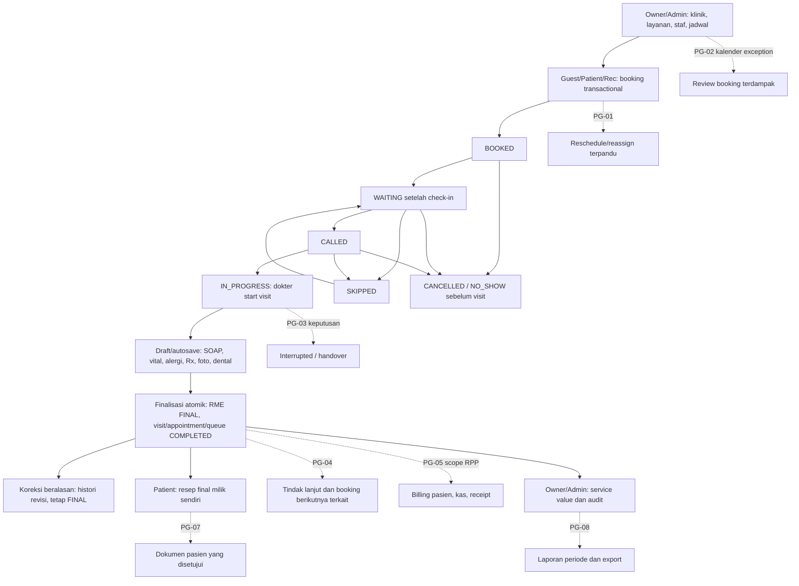
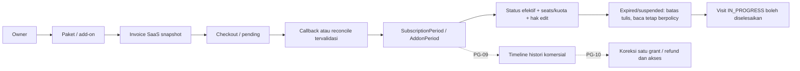

# Peta workflow operasional

Tanggal audit: **14 November 2026**. Audit produk read-only; tidak ada implementasi/perbaikan. Fakta source/UI dipisahkan dari inferensi kebutuhan dan rekomendasi. Semua UI menggunakan data dummy pada SQLite terisolasi. 

## Lifecycle nyata dan cabang yang belum lengkap

Diagram adalah peta alur bisnis ringkas, bukan semua guard enum. Otorisasi dan QueueWorkflowService menentukan cabang cancel/no-show yang benar-benar diizinkan; **tidak ada panah I → CANCELLED**. Garis putus-putus adalah kebutuhan/keputusan, belum implementasi.

| ID | Perjalanan / handoff | Status aktual | Yang tersedia / batas | Gap / bukti |
| --- | --- | --- | --- | --- |
| W-01 | Owner/Admin → klinik → layanan → staf → jadwal → buka booking | COMPLETE untuk setup dasar; PARTIAL exception tanggal | Setting, active switch, seats, jadwal mingguan; jam baru menjaga booking baru. | PG-02; contoh UI-12/13 |
| W-02 | Guest/Patient/Rec → pasien → sesi → booking → queue BOOKED | COMPLETE jalur dasar; kebijakan inactive belum seragam | Snapshot/idempotency/kuota dan portal booking tersedia. | PG-06,17; UI-11/18/22 |
| W-03 | Booking salah / dokter absen → pilih pengganti → konfirmasi | PARTIAL | Cancel pra-visit + booking baru terpisah; tidak ada hubungan/preview reschedule. | PG-01,02; UI-07/08 |
| W-04 | BOOKED → WAITING → CALLED → IN_PROGRESS → COMPLETED | COMPLETE jalur utama | Skip/return/no-show/cancel pra-visit, satu aktif, start oleh dokter, finalisasi atomik. | DFU dipertahankan; UI-08/09 |
| W-05 | IN_PROGRESS → dokter berhalangan / pelayanan terhenti | PRODUCT DECISION REQUIRED | Tidak ada abort/handover; draft tidak boleh dipaksa completed atau dibatalkan via DB. | PG-03; UI-09 |
| W-06 | Histori berizin → alergi → draft → diagnosis/tindakan/resep/foto/dental → final | COMPLETE jalur dasar; versi allergy belum selesai | Autosave/lock conflict nyata, add-on sah dan private policy; perlu resolusi dua editor. | PG-13; UI-09/10 + coverage dental historis |
| W-07 | Final → koreksi beralasan → revision tetap final | COMPLETE | Snapshot before/after dan aktor/waktu; tidak hard delete catatan final. | VisitWorkflowService + bukti fix historis |
| W-08 | Final → resep portal → dokumen / follow-up / next booking | PARTIAL | Resep final terlihat; dokumen terbit dan follow-up terhubung belum. | PG-04,07; UI-05/10/11 |
| W-09 | Visit selesai → tagihan → kas → kuitansi → rekonsiliasi | MISSING bersyarat scope RPP | Visit.total_amount hanya service value; bukan kas pasien. | PG-05; UI-17 + schema |
| W-10 | Owner → dashboard/audit → laporan keputusan periode | PARTIAL | Metrik dan filter tersedia, export/reconciled report belum. | PG-08; UI-01/16 |
| W-11 | Owner → paket/add-on → invoice → checkout → valid payment → entitlement | Source/backend tersedia; settlement eksternal NOT VERIFIED | Pending checkout/reconcile sandbox historis nyata; return browser tidak mengaktifkan. | Provider evidence terpisah; PG-16 packaging |
| W-12 | Platform → histori tenant → koreksi grant/refund → akses konsisten | PARTIAL / PRODUCT DECISION REQUIRED | Current effective status/invoice/refund recording tersedia; full timeline dan single-period recovery belum. | PG-09/10; UI-14/15/23 |
| W-13 | Tenant aktif → ownership change / suspend / closure / restore | PRODUCT DECISION REQUIRED | Clinic deactivation memblokir booking, bukan seluruh lifecycle kontrak. | PG-11; UI-12/14 |
| W-14 | Record lama mismatch → deteksi → keputusan → repair teraudit | PRODUCT DECISION REQUIRED; real user incidence NOT VERIFIED | Backfill terbatas ada; tidak memodifikasi database pengguna. | PG-14 |

## Lifecycle SaaS terpisah dari pelayanan

Pembayaran subscription tidak menjadi pembayaran kunjungan. Pengembalian dana provider tidak dibuktikan oleh perubahan status Payment lokal. Platform tidak mendapatkan isi RME untuk mengelola periode ini.
