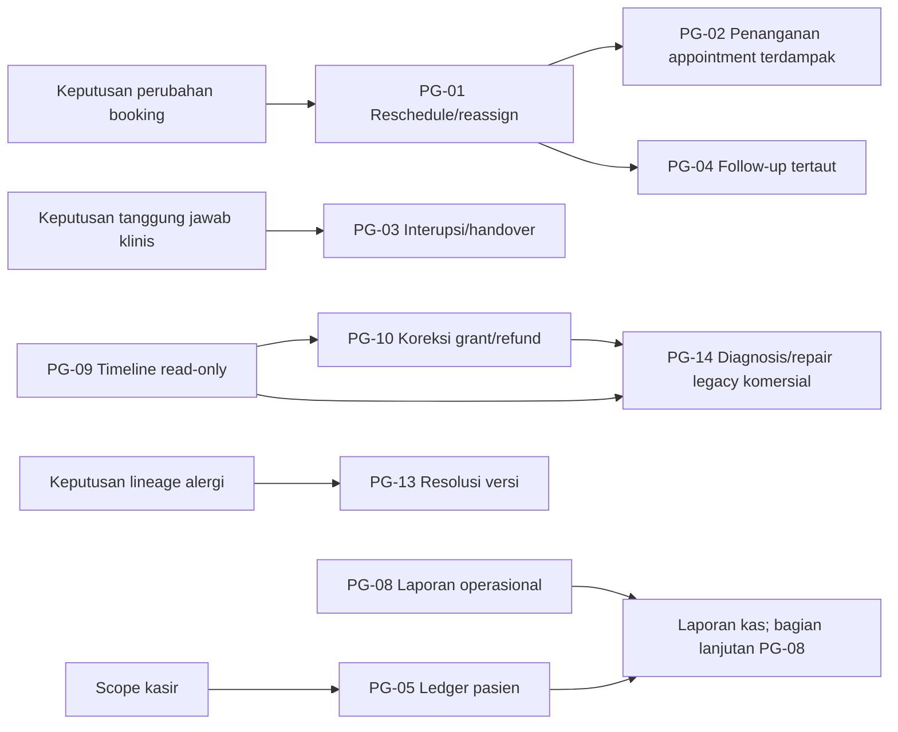

# Dependensi dan integritas lintas fitur

Tanggal audit: **14 November 2026**. Audit produk read-only; tidak ada implementasi/perbaikan. Fakta source/UI dipisahkan dari inferensi kebutuhan dan rekomendasi. Semua UI menggunakan data dummy pada SQLite terisolasi. 

| Sumber kemampuan | Handoff ke | Invariant / ketergantungan tersembunyi | Gap |
| --- | --- | --- | --- |
| Identity/tenant + role/policy | Semua resource query, link, background delivery, file dan export | clinic_id + relasi yang divalidasi; jangan mengandalkan Patient ClinicScope pada guest/console. | Semua gap |
| Clinic timezone/hours + doctor/service + schedule | Booking/session/queue quota dan reschedule | Snapshot historis dan local-date konsisten; setting baru hanya booking baru kecuali keputusan eksplisit. | PG-01,02,06 |
| Booking/Queue workflow | Check-in → doctor start → visit | Satu aktif per sesi, UUID replay, after-commit broadcast; cancel tidak melewati visit aktif. | PG-01,03 |
| Visit + RME + versions | Final/correction, allergy, photo/dental dan aftercare | Dokter assigned, lock/version, private storage; recipients nonmedis tidak menerima isi klinis. | PG-03,04,07,13 |
| Entitlement efektif + period ledger | Seats/kuota, read-only, dental edit dan grant/refund | Current cache bukan histori; expiry tidak memutus penyelesaian visit yang sudah berjalan. | PG-09,10,11,16 |
| SubscriptionPayment vs patient service value | Commercial support vs kasir/reports | Jangan reuse Payment SaaS untuk uang pasien; invoice snapshot ≠ receipt kunjungan. | PG-05,08,10 |
| Queue events + notification worker | Inbox/status dan usulan near-turn/reminder | Recipient ownership dicek saat delivery, dedup/retry, tidak ada PII publik. | PG-12; PR-01 terpisah |
| Audit + period/source links | Penjelasan commercial dan repair legacy | Append history, alasan/aktor, read-only diagnosis sebelum compensating adjustment. | PG-09,10,14 |
| Provider/SMTP/scheduler runtime | Checkout settlement, reminder dan lifecycle verifikasi | Source config bukan bukti provider callback/inbox/scheduler produksi aktif. | NOT VERIFIED eksternal |

## Urutan gap yang saling bergantung

Dependensi PG-02 pada PG-01 berlaku untuk **penyelesaian booking lama**; kalender exception + preview read-only dapat dikembangkan lebih dulu tanpa reschedule. PG-14 diagnosis read-only dapat dimulai sebelum koreksi PG-10, tetapi repair komersial menunggu kontraknya. PG-08 laporan service value tidak menunggu billing, sedangkan laporan kas wajib bergantung ledger PG-05.

## Data yang tersedia tetapi pemakaian berikutnya belum lengkap

SubscriptionPeriod/grant reason tersimpan tetapi full timeline Platform belum; Rx final tersimpan tetapi dokumen terbit belum; plan SOAP tersimpan tetapi tugas kontrol belum; appointment terdampak perubahan jam tetap sah historis tetapi tidak otomatis masuk daftar aksi; Visit.total_amount belum punya ledger kas; sibling allergy versions belum punya kontrak resolusi current. Referensi faktual dan AC masing-masing: [gap kanonis](MISSING_FEATURES_REPORT.md).

## Ketergantungan runtime dan akses yang tidak boleh disembunyikan

Worker/reverb/scheduler, transport mail, provider sandbox/callback, private disk dan schema constraints diperlukan menurut jalur fitur. Runtime audit sengaja memakai mail array/broadcast null dan dummy-only DB; indikator reconnect pada screenshot bukan temuan produk baru. Riwayat delivery Reverb, loopback SMTP dan checkout sandbox sebelumnya tidak membuktikan operasi deployment sekarang.

PR-01 berhubungan dengan boundary authorization channel lama, bukan ketiadaan UI permission. Jangan menunggu custom-role feature untuk mengerjakan risiko revokasi; lakukan track keamanan terpisah dengan bukti old-socket/reconnect/HTTP dan tanpa mengubah cakupan audit ini. PG-18 hanya binding feedback grant; backend idempotency tetap invariant lintas fitur.
