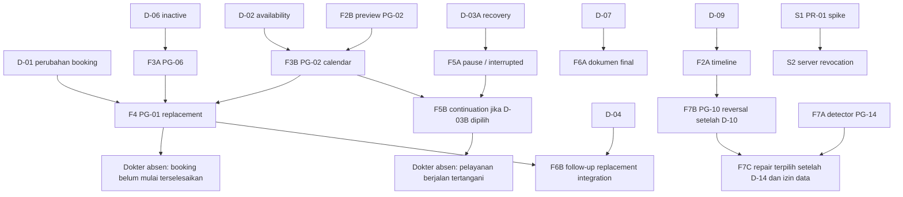

# Dependensi implementasi dan batas fase

Tanggal: 14 November 2026. Ini dependency delivery, bukan audit baru. **18 PG unik**; PR-01 existing mempunyai track sendiri. Fase/subfase adalah paket pekerjaan dari ID yang sama. Dependensi lunak memungkinkan pekerjaan mandiri; hard dependency tidak boleh dilewati dengan fixture yang menyamarkan fitur belum ada.

## Dependensi keras dan bagian yang dapat dipisahkan

| Paket | Dependensi keras | Tidak perlu menunggu | Alasan |
| --- | --- | --- | --- |
| F1A PG-18 | Fixture grant existing, request UUID existing | Seluruh keputusan klinis/komersial baru | Perbaikan render/pending saja |
| F1B PG-17 | Matcher/review token existing, tenant policy | Reschedule/kalender/kasir | Paging bukan linking identitas |
| S1 PR-01 spike | Source/API versi terpasang, fixture Reverb/worker saat implementasi | Permission editor, PG-15/16, semua gap klinis | Security boundary independent |
| S2 PR-01 fix | S1 membuktikan subscribe/delivery/terminate, PR-01/T | Kasir/kiosk/multibranch | Client disconnect saja tidak cukup |
| F2A PG-09 | D-09 allowlist/role | Revoke PG-10, clinical recovery | Viewer read-only bisa selesai sendiri |
| F2B PG-02 preview | Scope baca existing; D-02 menentukan bentuk input yang ditampilkan | Blocking calendar, PG-01 | Preview memberi bukti dampak tanpa mengubah booking |
| F3A PG-06 | D-06 | PG-01/03/09 | Makna inactive dapat diuji tiap kanal sendiri |
| F3B PG-02 calendar | D-02, availability predicate server | Reschedule PG-01 untuk blok baru | Pencegahan booking baru berbeda dari memindahkan booking lama |
| F4 PG-01 + resolusi PG-02 | D-01, kebijakan inactive D-06; predicate availability F3B bila exception dipakai | PG-03 untuk seluruh booking yang belum punya visit | Replacement tidak dapat dipakai pada visit aktif |
| F5A PG-03 pause/terminal | D-03A + enum/locking/entitlement readers | Reschedule dan handover bila diputuskan terpisah | Masing-masing punya terminal/exit criteria jelas |
| F5B PG-03 continuation | D-03B + F5A pada model rekomendasi, BookingService dan availability | PG-07 print, PG-04 follow-up | Handoff data private bukan dokumen cetak atau follow-up task |
| F5C PG-13 | D-13, allergy/RME version existing | PG-01/02/03 | Resolusi lineage tidak bergantung kalender |
| F6A PG-07 | D-07, final record/correction existing | Billing PG-05, follow-up PG-04, handover PG-03 | Dokumen final dapat diterbitkan dari visit normal |
| F6B PG-04 | D-04, BookingService; PG-01 ketika target dipindah | Print PG-07 | Task dapat dibuat/booked/completed sendiri; integrasi reschedule diuji saat tersedia |
| F7A PG-14 detector fixture | Kategori invariant D-14 minimum, zero-write contract | Viewer/reversal dan akses real data | Read-only fixture dapat mengungkap rule ambiguity tanpa mutasi |
| F7B PG-10 | D-10 + F2A PG-09 | Clinical reschedule/aftercare | Koreksi harus dapat dipreview terhadap histori |
| F7C PG-14 apply spesifik | D-14/izin data + detector + domain repair yang dipilih; PG-10 untuk commercial repair | Semua jenis repair lain | Jangan membuat repair engine generik |
| F8A PG-08 | D-08 + definisi metrik; reader PG-03 bila state baru sudah aktif | PG-05 untuk laporan operasional nonkas | Laporan kas tetap ditahan |
| F8B PG-12 | D-12 + queue/notification/worker existing; state changes PG-01/03 bila sudah aktif | Kasir/print | Reminder stale terhadap state baru harus ditangani; PR-01 bukan alasan mengirim PII publik |
| O1 PG-05 | Keputusan scope D-05 dan spesifikasi finansial tersendiri | Tidak ada fase inti bergantung ini | Kasir tidak otomatis menjadi exit gate target klinis |
| O2 PG-11 | D-11; PR-01 saat suspend/transfer mencabut akses | Delivery core lainnya | Lifecycle tidak membenarkan bypass medis |
| O3 PG-15 | D-15; staff/reset/verification existing | Custom permissions | Invitation dan delegation adalah pilihan terpisah |
| O4 PG-16 | D-16; SubscriptionService existing | Add-on baru/ledger pasien | Tidak mengubah Free atau snapshot invoice diam-diam |

F4 dapat dirancang/dibuktikan lebih dulu dengan jadwal mingguan existing jika calendar belum siap; integrasi exception menjadi hard gate sebelum mengklaim skenario dokter berhalangan lengkap. Follow-up minimum dapat dibuat sebelum PG-01; acceptance replacement target tetap menunggu PG-01. Ini merinci dependensi kondisional audit, bukan mengubah 18 ID atau menghapus gate.

## Graph utama

## Peta komponen yang harus ikut berubah

| Domain | Callers/readers yang harus ditelusuri sebelum edit | Invariant yang dipertahankan |
| --- | --- | --- |
| Booking/availability | Public/Patient/Receptionist controllers, requests, BookingService, DoctorSchedule/Clinic settings, booking-form.js, queues, status page | DFU-02, CCL-03/04/05, UUID/snapshot/kuota, guest secret |
| Queue/visit interupsi | QueueWorkflowService, VisitWorkflowService, Appointment/Queue/Visit enums, policies, active constraint, dashboards/ETA, realtime, job notifications, subscription middleware | DFU-01, atomic finalization, satu aktif, finish IN_PROGRESS, no PII publik |
| RME/allergy/documents | Save/Correct requests, record/allergy versions, Doctor/Patient endpoints, private photo, dental/add-on, histories, revision/print | Final immutable kecuali correction, assigned-doctor, no medical bypass |
| Commercial | Tenant/dashboard/current status, SubscriptionService, AddonService, DokuPaymentService, grants/refund/controller, invoice/addon views, reminder | DFU-12, CCL-06/08, invoice/period snapshots, valid callback, no delete |
| Auth/realtime | StaffAccountService, user activation/password/role/permission mutations, channels/auth response, Echo/queue realtime, notifications jobs, Reverb manager/delivery hooks | QA staff-session fixes, CCL-02/07 editor/filter, PR-01 server boundary |
| Reporting/follow-up | Dashboard dates/status queries, source/target links, VisitCompleted/appointment events dan consumers | DFU-07/08, task bukan medical share/kas, no stale deliveries |

## Tidak menjadi dependency otomatis

Kiosk, billing pasien, multi-cabang dan permission editor bukan prasyarat reschedule, interupsi, print resep, follow-up, viewer/grant recovery atau PR-01. Directory/React/native/Edge tidak ditambahkan. Provider settlement/refund nyata adalah bukti integrasi terpisah bila fitur tersebut dipilih, bukan alasan menyatakan fake test sebagai E2E. PR-02/03 MySQL test/factory historis dicatat ketika menguji fitur terkait; tidak dihitung PG baru dan tidak diselesaikan dengan menghapus test.
