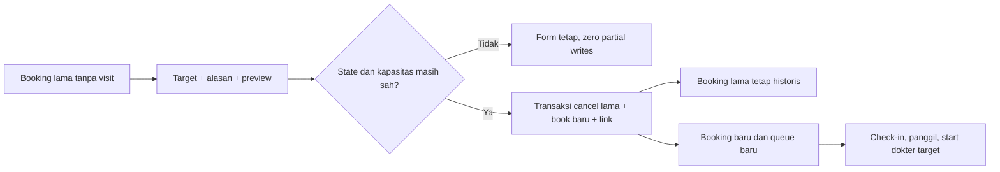
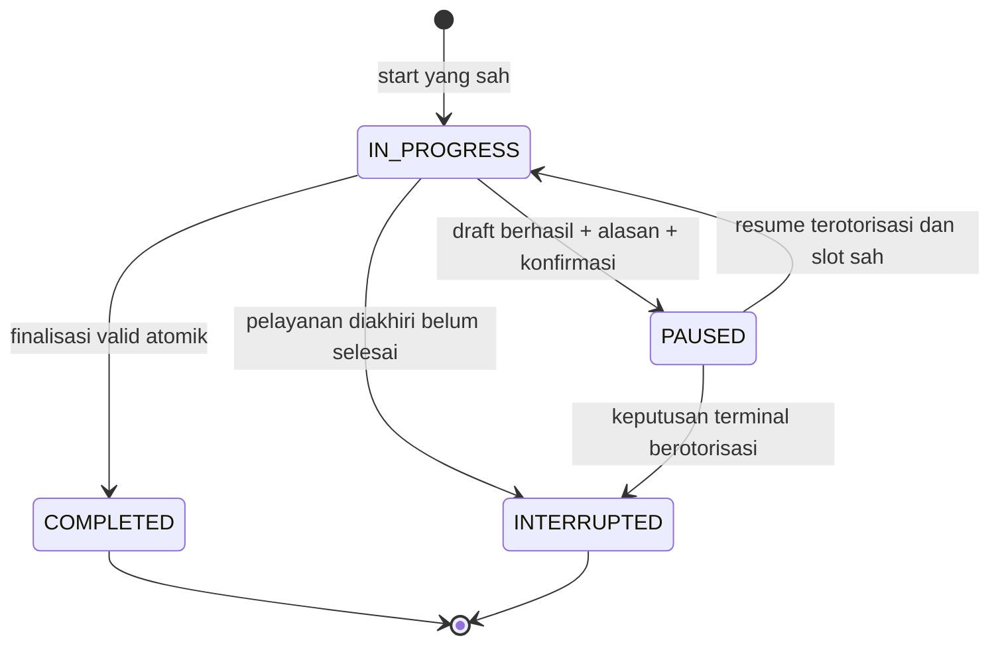
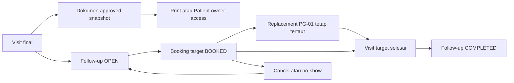

# Rancangan UI dan state operasional

Tanggal: 14 November 2026. Semua layar/aksi/state baru berikut **usulan**, tunduk pada [gate keputusan](DECISIONS_REQUIRED.md). Diagram bukan bukti bahwa fitur telah diimplementasikan. ID tetap PG-01–PG-18 dan PR-01 existing.

## Prinsip interaksi semua fase

Aksi ditempatkan pada detail booking, jadwal, editor visit, hasil final, task kontrol atau timeline tenant. Setiap submit menampilkan pending, hasil sukses dan next action; error mempertahankan pilihan/input. Konflik state meminta pengguna meninjau kondisi terbaru dan tidak melakukan destructive auto-refresh. Realtime refetch tidak mengganti form filter, kursor atau editor yang sedang digunakan (CCL-07/02).

Gunakan label programatis, ringkasan error/field errors, keyboard/fokus dialog, responsive375/768/1024/1440 dan empty/loading/error state sesuai task yang berubah. Jangan menambah skeleton tanpa kontrak loading. Empty harus menawarkan langkah yang benar bagi role tersebut, bukan tombol yang pasti 403. Setelah sukses, gunakan redirect/status atau update region yang jelas agar repeat submit tidak menjadi satu-satunya cara mengetahui hasil.

## 1. PG-01: reschedule/reassignment yang terpandu

| Langkah | Tindakan pengguna / layar | State server dan pemulihan |
| --- | --- | --- |
| 1 | Receptionist membuka detail booking, memilih Ubah jadwal/dokter | Policy tenant/status/no-visit; tampil alasan jika sudah mulai/final, arahkan PG-03 untuk interupsi |
| 2 | Pilih dokter/layanan/tanggal/sesi dan alasan | Slot hanya kandidat, belum reservasi; shared validation hours/exception/doctor-service/kuota |
| 3 | Preview dua kolom lama→baru | Tampilkan waktu timezone klinik, harga/delta sesuai D-01, kode/queue baru dan efek check-in; snapshot lama tidak diedit |
| 4 | Konfirmasi | UUID/fingerprint + expected state; transaksi old cancel/new book/link; tombol pending disabled |
| 5 | Sukses: Booking pengganti dibuat, link old/new | Old CANCELLED beralasan, new BOOKED atau status yang dipilih D-01; queue konsisten; hanya setelah commit kirim perubahan |
| 6 | Patient membuka booking baru; staf check-in/panggil, dokter target start | Uji sampai benar-benar dapat diperiksa; halaman sukses saja belum menutup workflow |
| E | Slot habis, patient inactive, harga berubah, visit baru dimulai, request lama | Zero partial writes; pertahankan form dan tampilkan alasan/pilih ulang. Replay hasil sama, payload berubah dengan UUID sama conflict |

Patient self-service memakai layar ekuivalen yang membatasi kepemilikan/cutoff yang disetujui. CALLED tidak dipindahkan tanpa explicit confirmation jika diizinkan. Guest lama tidak diberi secret baru hanya dari ID booking lama; minimal diberi kontak klinik. Jika memilih tidak memindahkan, booking lama tetap seperti semula. Pergantian layanan/dokter sebelum visit termasuk PG-01, bukan modul terpisah.

## 2. PG-02: dokter berhalangan sebelum atau saat shift

Owner/Admin dari Jadwal memilih dokter/klinik, rentang lokal, alasan dan preview dampak. F2B dapat menunjukkan dampak sebelum ada calendar blocker; F3B setelah D-02 memberi tombol Simpan blok. Header hasil menjelaskan “booking baru diblokir; booking lama belum dipindahkan”. Daftar dampak dapat disortir menurut sesi/status, bukan full clinical contents.

| State saat diketahui dokter absen | Aksi UI yang disarankan | Hal yang dilarang |
| --- | --- | --- |
| Belum ada booking | Simpan exception; halaman publik/portal tidak menawarkan sesi blocked | Mengubah weekly schedule permanen untuk satu hari tanpa penjelasan |
| BOOKED | Hubungi pasien; pilih PG-01 pindah dokter/sesi atau cancel sah dengan alasan | Membatalkan seluruh daftar tanpa konfirmasi |
| WAITING / SKIPPED | Daftar kedatangan tetap; pilih pengganti melalui PG-01, jelaskan reset/preservasi check-in sesuai D-01 | Mengganti doctor_id queue saja tanpa appointment/snapshot/link |
| CALLED | Tampilkan panggilan aktif dan konfirmasi dampaknya; pindah/cancel hanya bila D-01 mengizinkan | Menghilangkan active call di browser tanpa transisi server |
| IN_PROGRESS | CTA Koordinasikan pelayanan terinterupsi → PG-03; Rec hanya metadata | Cancel/rebook PG-01 atas appointment yang sudah mempunyai visit |
| PAUSED jika F5A tersedia | Resume dokter semula bila memungkinkan atau continuation setelah persetujuan klinis | Memulai resume saat slot dokter lain sudah aktif |
| COMPLETED / FINAL | Tampilkan read-only, tidak masuk mutasi reschedule | Menggeser appointment historis karena setting baru |
| Tidak ada target/kapsitas / semua dokter absen | Tampilkan belum terselesaikan, kontak/penjadwalan lain, task tetap terlihat | Menganggap masalah selesai karena exception tersimpan atau memaksa COMPLETED |

Resolusi minimum satu per satu, dengan ringkasan berapa masih perlu tindakan. Menonaktifkan exception membuka ketersediaan baru, tidak membalikkan reschedule/cancel historis. Notifikasi pasien tidak menyebut alasan pribadi ketidakhadiran dokter. Bila klinik memilih prosedur luar sistem, catatan operasional hasil komunikasi tidak boleh memalsukan hasil medis.

## 3. PG-03: interupsi, pemulihan dan handover

### F5A: jeda/resume dan penghentian jujur

Diagram ini berlaku **jika D-03A disetujui**. Status tambahan tidak ada pada baseline sekarang.

Dokter memilih jeda/akhiri → verifikasi draft tersimpan versi benar → preview dampak antrean/hasil → alasan → konfirmasi. Editor paused/interrupted tidak terus autosave; server menolak writer lama dengan state conflict, DOM input tetap dapat disalin. Resume menampilkan draft sebelumnya dan meminta review alergi bila versi berubah. Reconnect/reauth tidak memulai ulang pelayanan otomatis.

Completed menghasilkan RME final/appointment dan queue completed seperti existing. Interrupted menghasilkan status non-completed, draft retained dan alasan/waktu/aktor; Patient tidak menerima resep draft sebagai final. Pause dapat membebaskan active slot sesuai keputusan, tetapi resume harus mengambil slot kembali secara atomik. Tidak ada jalur IN_PROGRESS→CANCELLED untuk mengakali DFU-01.

### F5B: dokter penerima, bukan penggantian penulis lama

1. Dokter penanggung jawab atau klinisi pengganti yang secara eksplisit diotorisasi D-03B membuka permintaan continuation dari visit paused/aktif. Jika dokter semula tidak tersedia dan belum ada kewenangan override yang sah, UI hanya memberi jalur eskalasi; Admin/Rec tidak membaca isi medis untuk mengisi handoff.
2. Pengirim memilih dokter target, alasan dan informasi handoff minimum yang disetujui; source tetap tersedia untuk penulisnya. Permintaan mempunyai status requested, bukan accepted otomatis.
3. Dokter penerima meninjau paket yang diizinkan dan menerima/menolak. Penolakan mengembalikan next action tanpa menghapus source/draft. Bila penerima belum berwenang melihat detail sebelum acceptance, UI awal hanya metadata minimum sesuai D-03B.
4. Saat diterima dan sesi target valid, transaksi membuat/menautkan episode lanjutan dan menutup source sebagai interrupted menurut pilihan D-03B. Source visit/RME/author tetap, tidak menggunakan PG-01 untuk membatalkan source yang sudah diperiksa.
5. Staf mengatur kedatangan/queue tujuan sesuai keputusan check-in; dokter penerima mulai RME sendiri. Link continuation menampilkan urutan episode dan siapa mengerjakan bagian mana.
6. Finalisasi target mengikuti workflow normal. Hubungan tindak lanjut/handover tidak menjadikan source completed. Hak baca paket handoff dibatasi resource/assignment dan dicabut sesuai ketentuan; tidak membuka seluruh histori pasien lintas dokter.

Tarif/kuota/expired continuation menunggu D-03B. Mengikuti rekomendasi episode baru tanpa memutuskan hal itu dapat menghalangi pelayanan lanjutan; karena itu F5B tidak dianggap siap hanya dengan menambah tombol. Model satu visit/current assignment adalah alternatif, bukan fitur tambahan yang akan dibuat bersama.

## 4. PG-07 dan PG-04: hasil pelayanan sampai kontrol selesai

Dokter final → ringkasan hasil dengan dua aksi terpisah: Terbitkan dokumen dan Buat tindak lanjut. Keduanya tidak mengubah isi RME final. Patient hanya mendapat dokumen/instruksi yang secara eksplisit disetujui.

**Dokumen:** pilih tipe yang disepakati → preview allowlist → issue UUID/version → print halaman khusus → buka ulang snapshot dari daftar dokumen. Koreksi RME menandai dokumen lama perlu review/superseded sesuai D-07; tidak mengganti isi dokumen yang telah diterbitkan. Reprint menampilkan versi/waktu/issuer yang sama. Pasien tanpa akun menggunakan penyerahan manual oleh klinik yang diotorisasi, bukan auto-link akun atau public medical URL baru.

**Follow-up:** dokter memasukkan rentang kontrol dan instruksi yang dibagi → OPEN. Patient/Rec menjadwalkan dengan clinic/patient/context yang sudah benar → BOOKED. PG-01 memindahkan target bila jadwal berubah dan task tetap terhubung. Hanya visit target selesai → COMPLETED. Cancel/no-show → reopen atau review sesuai D-04; task tidak lenyap. Kontrol melewati horizon booking tetap OPEN dengan petunjuk kapan dapat dijadwalkan.

Panah cancel/no-show→OPEN adalah **rekomendasi menunggu D-04**, bukan aturan existing. Instruksi medis dan metadata penjadwalan adalah dua payload berbeda; Rec tidak perlu melihat diagnosis/SOAP untuk membuat jadwal. Tidak ada tagihan/kasir otomatis setelah final.

## 5. PG-09 dan PG-10: histori dahulu, correction kemudian

Platform → Tenant → Riwayat → filter/lini masa seluruh periode → pilih periode → lihat source, waktu efektif/terjadwal/revoked, invoice jika ada, actor/reason yang disetujui → buka detail invoice/audit berizin. Viewer tidak mempunyai side effect grant/revoke.

Setelah D-10 dipilih: pada grant manual yang eligible → Koreksi grant ini → alasan + preview status/akses/add-on yang terdampak, periode sah lain tetap → konfirmasi UUID/version → reversal selesai atau conflict. Hasil menampilkan hak sebelum/sesudah dan link audit, bukan “refund uang berhasil” bila hanya pencatatan/revoke. Periode paid diarahkan prosedur payment yang sesuai, tidak diproses sebagai grant manual.

Kasus duplicate historis memakai langkah yang sama setelah identifikasi read-only, bukan menghapus dua period lalu membuat satu baru. Jika tidak ada periode efektif setelah revoke, UI menyebut hasil sesuai D-10, tanpa otomatis memberi Free/grace. Visit IN_PROGRESS tetap mengikuti pengecualian penyelesaian existing. Owner history subset hanya bila D-09 disetujui; owner invoice/add-on history existing tetap tersedia.

## 6. PG-18: submit grant yang jelas

Detail tenant → pilih plan + alasan → validasi native/server → pending button disabled/teks Memproses → sukses redirect + status. Empty catalog tetap disabled; form invalid tidak masuk state pending. HTTP/provider failure kembali ke form dengan error yang jelas dan pilihan tersimpan; UUID reuse mengikuti hasil request server sehingga retry tidak membuat grant ganda. Assertion browser memeriksa console, DOM disabled dan keyboard submit, bukan hanya jumlah periode akhir.

## 7. PR-01: revoke dari server dan recovery editor

Admin menonaktifkan staf → transaksi akun/hak dan security version → hak HTTP efektif dicabut → server private guard menolak subscribe/delivery yang tak lagi sah → terminasi koneksi user setelah commit → UI admin menunjukkan status accepted/pending/error control tanpa mengaktifkan staf kembali. Private connections lama tanpa signed identity ditutup/ditolak server.

Browser staf yang dicabut menerima status akses bila memungkinkan atau mengalami koneksi putus; polling request berikutnya ditolak. Editor tidak diarahkan/reload/clear otomatis: teks/file pending tetap sampai pengguna memilih pemulihan. Login baru hanya bila akun masih sah; account inactive diberi alasan menghubungi admin. Pengguna sah di klinik sama tetap menerima queue update dan dapat reconnect/refetch, filter/cursor tetap. Public queue-board nonmedis tidak kehilangan fungsi karena satu pengguna dicabut.

SLA/barrier dan failure contract mengikuti PR-01/T. Jangan menggambarkan client event “logout” sebagai penegakan keamanan; semua frame private dinilai server, termasuk notification users.{id} dan worker backlog. Tidak ada janji menarik frame yang sudah dikirim sebelum revokasi.

## 8. Jalur pelengkap untuk ID lainnya

| ID | Alur UI minimum / pemulihan |
| --- | --- |
| PG-06 | Booking profil nonaktif → alasan + kontak/Edit profil berizin → reaktivasi eksplisit bila sah → kembali booking profil yang sama; tidak membuat pasien baru |
| PG-08 | Dashboard/report → filter valid → angka dan detail penjelas → CSV → empty nol atau error dengan filter tetap; label bukan kas |
| PG-12 | Notification near-turn yang relevan → booking/queue sendiri → status terkini; stale/cancelled tidak meminta datang; channel luar ditahan |
| PG-13 | Edit alergi stale → konflik dan input lokal → review versi → resolve berizin → banner/version baru; bukan auto-merge |
| PG-14 | Dry-run berizin → daftar mismatch minimum → pilih kategori/next step → approval repair spesifik → apply fingerprint/UUID → audit; real data menunggu izin terpisah |
| PG-15 | Jika dipilih: undang → set password → verify → tugas role; expired/revoke/resend jelas. Delegated admin tidak ikut otomatis |
| PG-16 | Jika dipilih: plan matrix menjelaskan hak; pembatasan baru hanya setelah kontrak/transisi, bukan mematikan Free dari metadata |
| PG-17 | Panel kandidat → has-more + Lihat kandidat lain → profil tab baru → original input tetap → booking existing atau create setelah review |
| PG-05 | Kasir eksternal tetap; tidak menambah CTA/role/schema billing sebelum D-05 |
| PG-11 | Jika dipilih: permintaan lifecycle → verifikasi → preview dampak → konfirmasi → history/recovery; active clinic switch existing tetap |

Semua empty states diuji per role/resource fixture yang relevan; tidak menyatakan seluruh G47 atau studi usability manusia selesai berdasarkan wireflow ini.
